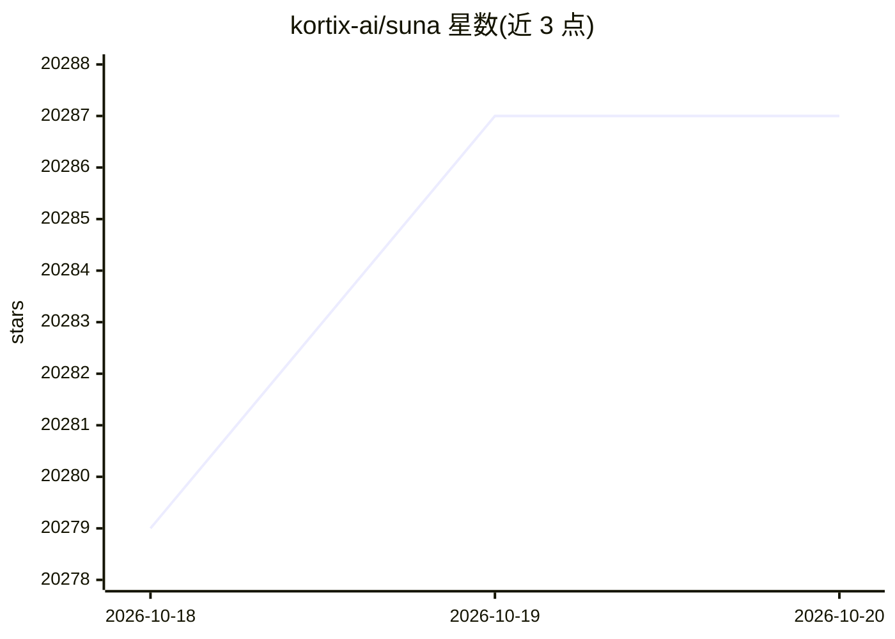

# kortix-ai/suna

⭐ 20,287 · TypeScript · NOASSERTION · 推送 2026-10-19 · [GitHub](https://github.com/kortix-ai/suna) · [官网](https://www.kortix.com) · 组织维护

**开源自托管 AI 操作系统：团队用 Agent 交付并审批实际工作**

以 git 仓库承载整个组织的 Agent 配置：agents、skills、记忆与连接器均以文件形式版本化。每个会话在独立云沙箱分支上运行，产出的变更经人工批准的 change request 合入 main。支持 Slack/Microsoft Teams 接入、cron/webhook 触发、每工具的 Allow/Ask/Block 审批门、3,000+ 应用连接器、SAML SSO 与审计日志。通过 Docker Compose 自托管，或使用 Kortix Cloud 托管服务；模型可自选提供商并使用自己的 API key。

## 筛选速览

| 维度 | 判定 | 备注 |
|---|---|---|
| AI 角色 | `ai-native` | 本体是模型或模型工具 |
| 许可风险 | `none` | NOASSERTION |
| 部署形态 | `self-host` | docker 或自建部署 |
| 模型依赖 | — | README 未给出锁定关系 |
| 硬件要求 | — | 无带数字的原话,不猜 |
| 安装摩擦 | `low` | 无编译、无系统依赖或容器化 |
| 成熟度 | — | 结构信号不足 |

## 动量与使用信号

- 维护:`active` — 距上次 push 0.7 天,年发版 100,74 位贡献者
- 涨星:近 1 天 **+3**(自 20261016 起算)
- 平台:WEB · 协议:MCP

## 能力要点

- 公司配置全部为 git 仓库内文件，可版本化、diff 与审计
- 每会话独立隔离沙箱，变更默认拒绝合并、需人工审批 change request
- 3,000+ 应用连接器加 MCP/OpenAPI/GraphQL/HTTP，凭据服务端代理
- cron 与签名 webhook 自动触发会话

## 适用场景

- 团队自托管替代方案运行有审批门的 AI Agent
- 在 Slack/Teams 里 @机器人 分派任务并在线程内收取成果
- 用 Agent 定时替代 Zapier 式自动化流程
- 后台云端编码 Agent 修 bug 并提 PR 待人审

## 场景标签

`工作流自动化` `编码 Agent` · 领域:效率与自动化

## 证据(README 行号)

> L5: **The open-source AI Operating System**
> L22: **Kortix is the one you own.** It's an open-source **AI Operating System**: your agents, the
> L24: diffable, and shared by the whole company. The agents work on real **cloud computers** — an

## 星数曲线

2026-10-18 20,279 → 2026-10-20 20,287（+8）

---
*卡片 v1 · prompt 1.4 · 生成 2026-10-18 · 置信度 high · 依据 README sha `9c53f8382dea` · [字段定义](../../DATASET.md)*
