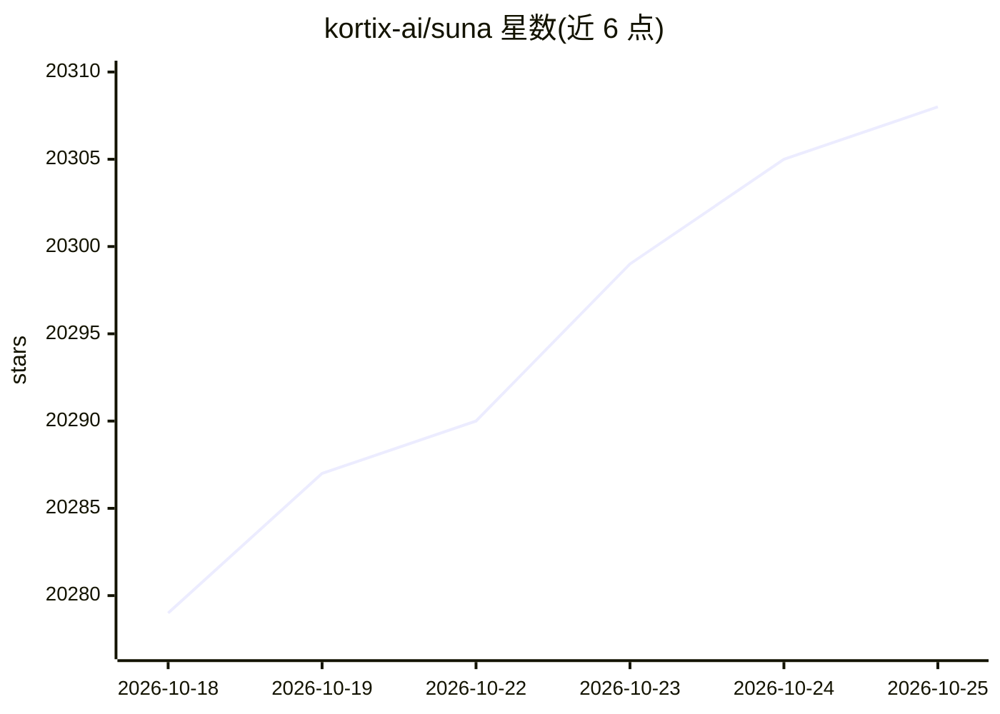

# kortix-ai/suna

⭐ 20,308 · TypeScript · NOASSERTION · 推送 2026-10-24 · [GitHub](https://github.com/kortix-ai/suna) · [官网](https://www.kortix.com) · 组织维护

**开源 AI 操作系统：自托管运行企业 AI agent 团队**

Kortix 以『AI 操作系统』定位为企业提供 agent 工作平台：agent、技能、记忆、连接器与触发器以文件形式存放于一个 git 仓库，版本化并评审。每个会话在独立的云沙箱（自有分支）中运行 OpenCode agent，产出通过 change request 由人审批合并。支持 Slack/Microsoft Teams 渠道、cron/webhook 触发器、3,000+ 应用连接（含 MCP/OpenAPI/GraphQL），任意模型供应商自带 key。自托管免费（Docker Compose），另提供托管云；不支持纯固定流程图编排。

## 筛选速览

| 维度 | 判定 | 备注 |
|---|---|---|
| AI 角色 | `ai-native` | 本体是模型或模型工具 |
| 许可风险 | `none` | NOASSERTION |
| 部署形态 | `self-host` | docker 或自建部署 |
| 模型依赖 | — | README 未给出锁定关系 |
| 硬件要求 | — | 无带数字的原话,不猜 |
| 安装摩擦 | `low` | 无编译、无系统依赖或容器化 |
| 成熟度 | — | 结构信号不足 |

## 动量与使用信号

- 维护:`active` — 距上次 push 0.7 天,年发版 100,74 位贡献者
- 涨星:近 1 天 **+3**(自 20261016 起算)
- 平台:WEB · 协议:MCP

## 能力要点

- agent/技能/记忆/连接器集中于一个 git 仓库，版本化可评审
- 每会话独立云沙箱，产出经 change request 人工审批合并
- 3,000+ 应用连接，支持 MCP/OpenAPI/GraphQL/raw HTTP
- SAML 2.0 SSO、SCIM 2.0、审计日志与按资源权限

## 适用场景

- 为团队部署自托管的 AI agent 工作平台替代 SaaS 方案
- 在 Slack/Teams 中让 agent 处理工单、起草回复并等待审批
- 用 cron/webhook 触发自动化 agent 任务替代固定流程编排
- 后台编码 agent 在云端沙箱修复 bug 并提交变更请求

## 场景标签

`多智能体` `Agent 框架` `编码 Agent` `工作流自动化` · 领域:Agent 开发

## 证据(README 行号)

> L22: **Kortix is the one you own.** It's an open-source **AI Operating System**: your agents, the
> L25: isolated sandbox per session, on its own branch — and land what they produce through a **change
> L114: Kortix is the leading open-source alternative to Claude Cowork and ChatGPT Work. Your team uses it

## 星数曲线

2026-10-18 20,279 → 2026-10-25 20,308（+29）

---
*卡片 v1 · prompt 1.4 · 生成 2026-10-20 · 置信度 high · 依据 README sha `856e39a0489e` · [字段定义](../../DATASET.md)*
