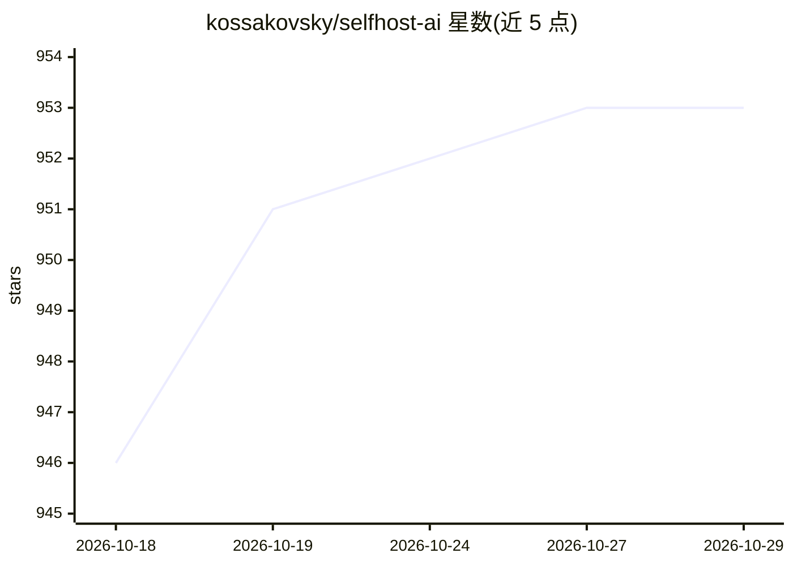

# kossakovsky/selfhost-ai

⭐ 953 · Shell · Apache-2.0 · 推送 2026-10-27 · [GitHub](https://github.com/kossakovsky/selfhost-ai) · [官网](https://github.com/kossakovsky/selfhost-ai#readme) · 个人维护

**一条命令在自有服务器部署 30+ 开源自托管 AI 工具栈**

面向自建 homelab/VPS 的 Docker Compose 安装器：交互式向导选装 n8n、Ollama、Open WebUI、OpenClaw、Dify、Flowise/Keelflow、Supabase、ComfyUI、Qdrant、RAGFlow、Langfuse 等 30 余个 AI 与自动化服务，自动生成密钥、统一经 Caddy 反向代理提供自动 HTTPS，内置 Grafana/Prometheus 监控与 make doctor 诊断。要求 Ubuntu 24.04 VPS、公网 IP 与泛域名解析，最低 4 GB RAM，全部服务建议 20 GB RAM。Apache 2.0，安装器经 Scarf 发送匿名统计，可关闭。

## 筛选速览

| 维度 | 判定 | 备注 |
|---|---|---|
| AI 角色 | `ai-ecosystem` | LLM/agent 周边工具 |
| 许可风险 | `permissive` | Apache-2.0 |
| 部署形态 | `self-host` | docker 或自建部署 |
| 模型依赖 | local-ok | 支持本地模型 |
| 硬件要求 | — | 无带数字的原话,不猜 |
| 安装摩擦 | `low` | 无编译、无系统依赖或容器化 |
| 成熟度 | — | 结构信号不足 |

## 能力要点

- 单命令安装向导：选服务、生成全部密钥、Caddy 自动 HTTPS
- 覆盖本地 LLM、AI agent、RAG/向量库、工作流自动化等 30+ 服务
- Grafana/Prometheus 监控、健康检查与 make doctor 诊断
- 支持 CPU/NVIDIA/AMD 及多 GPU 运行本地模型

## 适用场景

- 在自己的 VPS 上搭建私有 AI 工作流与聊天平台
- 以自托管方式替代 Zapier/Make/ChatGPT 服务
- 运维需要统一域名、HTTPS 与监控的自托管 AI 工具集合

## 场景标签

 · 领域:自托管 AI 基础设施

## 证据(README 行号)

> L8: **Deploy 30+ open-source AI and automation tools on your own server with a single command.** Selfhost AI is a Docker
> L12: You need a VPS with a public IP running **Ubuntu 24.04 LTS** (4 GB RAM / 2 CPU for n8n and monitoring; 20 GB RAM / 

## 星数曲线

2026-10-18 946 → 2026-10-29 953（+7）

---
*卡片 v1 · prompt 1.4 · 生成 2026-10-21 · 置信度 high · 依据 README sha `1d2497d59116` · [字段定义](../../DATASET.md)*
