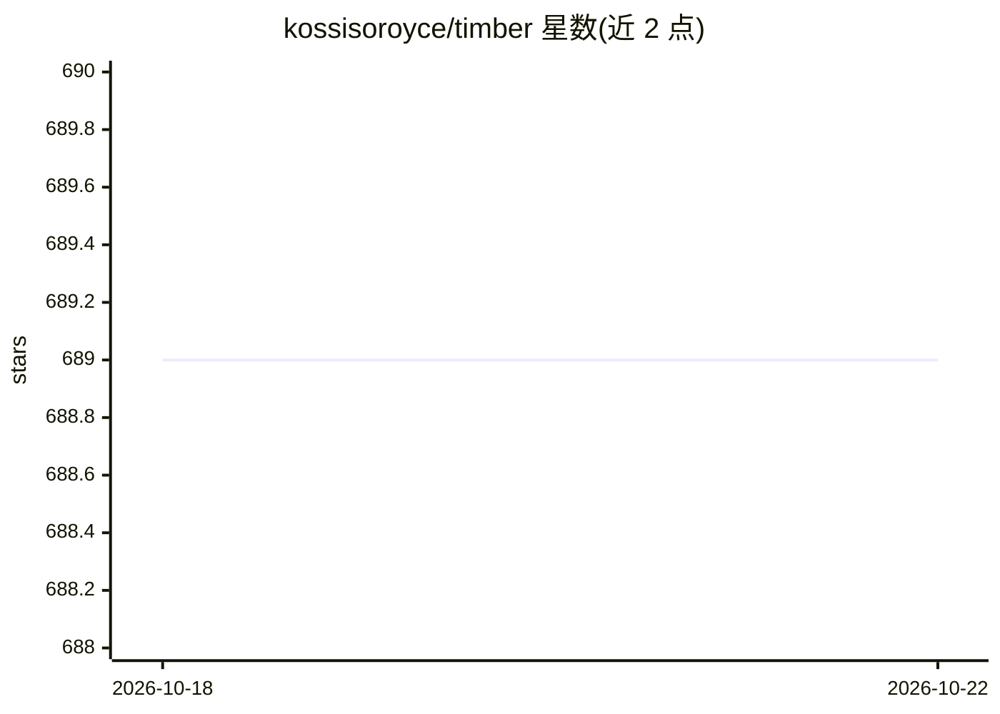

# kossisoroyce/timber

⭐ 689 · Python · NOASSERTION · 推送 2026-04-16 · [GitHub](https://github.com/kossisoroyce/timber) · [官网](https://kossisoroyce.github.io/timber/) · 个人维护

**将经典 ML 模型 AOT 编译为 C99 推理代码的工具链与服务**

Timber 读取 XGBoost、LightGBM、scikit-learn、CatBoost、ONNX 模型或 URDF 机器人描述文件，经多趟优化编译生成零运行时依赖的自包含 C99 推理产物，并内置 Ollama 兼容 HTTP 服务器，用 timber load/serve 两条命令完成加载与服务。面向需要亚毫秒级推理的交易路径、边缘嵌入式部署与受监管行业的团队。附带 timber accel 后端：SIMD/GPU/FPGA/嵌入式目标、WCET 分析、DO-178C/ISO 26262/IEC 62304 认证报告（README 自述为 advisory only）、签名加密与 gRPC/ROS 2/PX4 部署生成器。限制：ONNX 不支持神经网络层算子，CatBoost 需 JSON 导出，XGBoost 二进制 booster 不支持。

## 筛选速览

| 维度 | 判定 | 备注 |
|---|---|---|
| AI 角色 | `ai-ecosystem` | LLM/agent 周边工具 |
| 许可风险 | `permissive` | NOASSERTION |
| 部署形态 | `library` | 以包/库形式分发 |
| 模型依赖 | local-ok | 支持本地模型 |
| 硬件要求 | — | 无带数字的原话,不猜 |
| 安装摩擦 | `medium` | 含编译或系统依赖之一 |
| 成熟度 | — | 结构信号不足 |

## 能力要点

- 多框架模型（XGBoost/LightGBM/sklearn/CatBoost/ONNX/URDF）编译为无运行时依赖的 C99 产物
- 内置 Ollama 兼容 HTTP 服务器，一条命令加载、一条命令服务
- timber accel 提供 SIMD/GPU/FPGA/嵌入式后端与 WCET、认证报告、Ed25519 签名、AES-256-GCM 加密
- 基准自述单样本推理约 2 µs、产物约 48 KB

## 适用场景

- 把训练好的梯度提升模型部署到无 Python 环境的生产或边缘设备
- 在交易路径中以微秒级延迟运行欺诈/风控模型
- 为 Cortex-M/ESP32 等嵌入式目标生成 C99 推理代码
- 用 curl 直接调用本地模型服务做批量预测

## 场景标签

`推理引擎` · 领域:训练与推理

## 证据(README 行号)

> L17: Timber takes a trained ML model — XGBoost, LightGBM, scikit-learn, CatBoost, ONNX (tree ensembles, linear models, S
> L76: 5. **Serve** — an Ollama-compatible HTTP API wraps the binary for drop-in integration

## 星数曲线

2026-10-18 689 → 2026-10-22 689（+0）

---
*卡片 v1 · prompt 1.4 · 生成 2026-10-21 · 置信度 high · 依据 README sha `6819c28a0512` · [字段定义](../../DATASET.md)*
