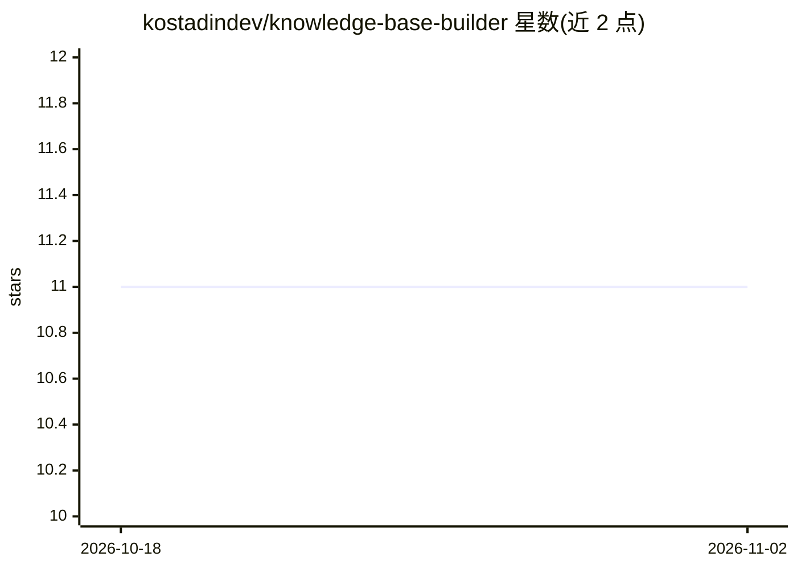

# kostadindev/knowledge-base-builder

⭐ 11 · Python · MIT · 推送 2026-08-16 · [GitHub](https://github.com/kostadindev/knowledge-base-builder) · [官网](https://pypi.org/project/knowledge-base-builder/) · 个人维护

**从网页/PDF/GitHub 等来源生成结构化 Markdown 知识库**

Python 包 knowledge-base-builder：接收 URL、本地文件、GitHub user/repo 简写、YouTube、arXiv、RSS、notebook、PPT 等多种来源，自动路由到对应提取器，合并为单一 LLM 结构化 Markdown 文档。支持输出 Markdown、/llms.txt 规范文本与向量库 JSON chunks，面向 RAG、搜索友好 LLM 上下文与聊天机器人场景。API key（Google/OpenAI/Anthropic）从环境变量读取，无 key 时回退为原始提取模式仍可产出结果；提供 CLI 与可选 extras 安装。

## 筛选速览

| 维度 | 判定 | 备注 |
|---|---|---|
| AI 角色 | `ai-ecosystem` | LLM/agent 周边工具 |
| 许可风险 | `permissive` | MIT |
| 部署形态 | `library` | 以包/库形式分发 |
| 模型依赖 | — | README 未给出锁定关系 |
| 硬件要求 | — | 无带数字的原话,不猜 |
| 安装摩擦 | `low` | 无编译、无系统依赖或容器化 |
| 成熟度 | — | 结构信号不足 |

## 能力要点

- 覆盖文档/表格/网页/GitHub/YouTube/arXiv/RSS/notebook/PPT 等 10 类来源
- 输出格式含 Markdown、/llms.txt 规范文本与向量库 JSON chunks
- 无 API key 时回退原始提取（raw 模式）仍可产出结果
- 提供 Python API 与 CLI 两种调用方式

## 适用场景

- 把网站、PDF、GitHub 仓库整合成一份知识库文档
- 为自己的站点生成 /llms.txt 供 LLM 检索
- 将资料转为 chunks JSON 供向量库摄入

## 场景标签

`知识库管理` `RAG` `文档解析` · 领域:知识与检索

## 证据(README 行号)

> L13: LLM-structured document. Built for RAG, `/llms.txt`, vector-DB ingestion, and chatbots.
> L30: right extractor. Keys are read from the environment (`GOOGLE_API_KEY` / `OPENAI_API_KEY` /
> L73: kbb.build("guide.pdf", "https://mysite.com/faq", out="chunks.json", output_format="chunks")  # vector-DB JSON

## 星数曲线

2026-10-18 11 → 2026-11-02 11（+0）

---
*卡片 v1 · prompt 1.4 · 生成 2026-11-02 · 置信度 mid · 依据 README sha `d1c91fdd6893` · [字段定义](../../DATASET.md)*
