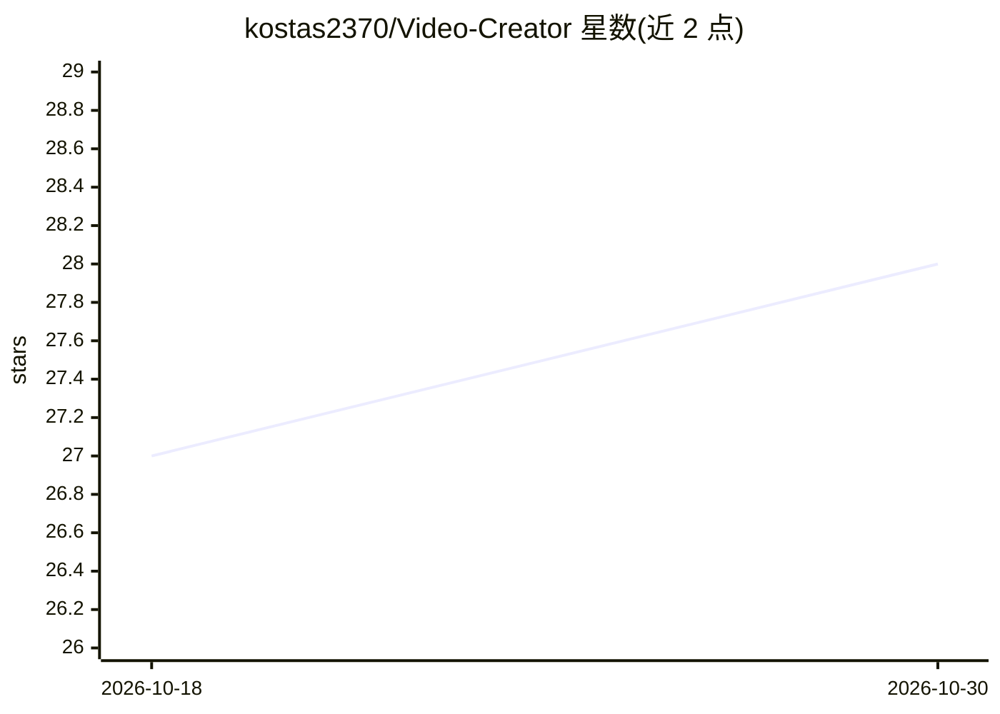

# kostas2370/Video-Creator

⭐ 28 · Python · AGPL-3.0 · 推送 2026-10-29 · [GitHub](https://github.com/kostas2370/Video-Creator) · 个人维护

**自托管的 AI 视频生成 Web 应用：提示词生成可编辑视频**

Viddie 是一个 React 前端 + Django API + Celery worker 的 Web 应用：用户输入提示词后生成故事板草稿，可先审阅并编辑对白与视觉提示词，再调用 OpenAI 图像/Sora 视频与 OpenAI、ElevenLabs、60dB 等语音服务生成媒体，逐场景修改后渲染成片，支持字幕、转场、静图动画、水印叠加与竖屏/方形输出。SadTalker 与 GFPGAN 权重在首次启动时自动下载，用于生成口型同步的主持人形象。语音均为 API 生成，本地 TTS（coqui）已被移除。提供 Docker Compose 一键部署与手动安装两种方式。

## 筛选速览

| 维度 | 判定 | 备注 |
|---|---|---|
| AI 角色 | `ai-native` | 本体是模型或模型工具 |
| 许可风险 | `viral` | AGPL-3.0 |
| 部署形态 | `self-host` | docker 或自建部署 |
| 模型依赖 | — | README 未给出锁定关系 |
| 硬件要求 | — | 无带数字的原话,不猜 |
| 安装摩擦 | `low` | 无编译、无系统依赖或容器化 |
| 成熟度 | — | 结构信号不足 |

## 能力要点

- 提示词→故事板→逐场景编辑→渲染的完整流程
- 媒体来源可选：网页图片、OpenAI 图像/Sora、自定义图像与视频 API
- 旁白支持 OpenAI、ElevenLabs、60dB 或自定义语音服务，可加 SadTalker 主持人
- Docker Compose 同时启动 API、worker、数据库与前端，自动下载模型权重

## 适用场景

- 输入一句提示词生成带旁白和字幕的短视频
- 在渲染前逐场景修改对白、替换视觉素材并预览
- 自托管一个面向团队的 AI 视频生成平台，统一管理各服务的 API key

## 场景标签

`视频生成` `语音合成` · 领域:内容生成

## 证据(README 行号)

> L3: Viddie turns a prompt into an editable video. Draft a storyboard, review its dialogue
> L10: - **Review before generation:** edit the generated storyboard before creating audio
> L13:  image and video APIs. Optional reference images guide OpenAI images and Sora shots.

## 星数曲线

2026-10-18 27 → 2026-10-30 28（+1）

---
*卡片 v1 · prompt 1.4 · 生成 2026-10-26 · 置信度 high · 依据 README sha `aa8924ff87b2` · [字段定义](../../DATASET.md)*
