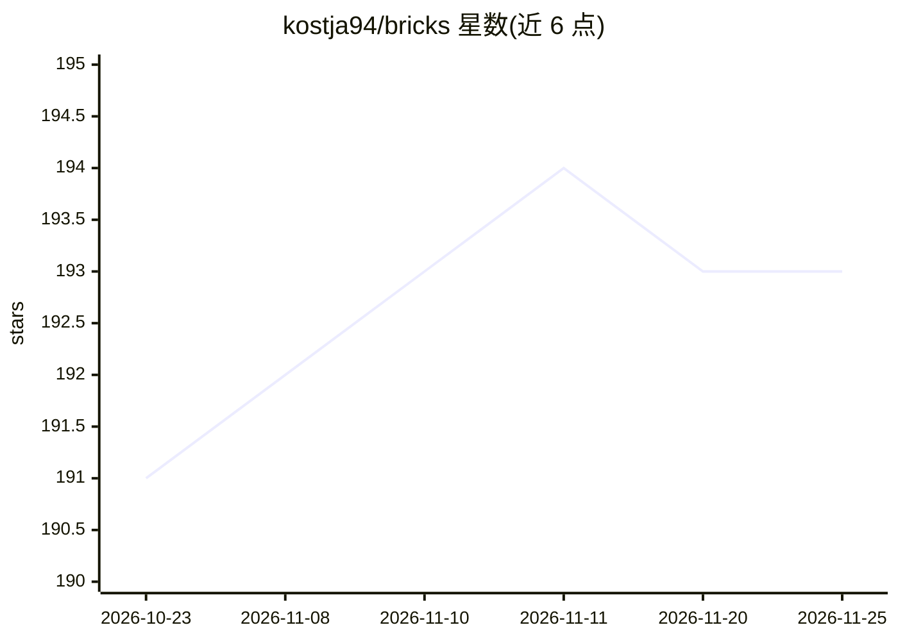

# kostja94/bricks

⭐ 193 · JavaScript · MIT · 推送 2026-11-06 · [GitHub](https://github.com/kostja94/bricks) · [官网](https://alignify.co/products/bricks) · 个人维护

**为编码 agent 提供组件契约层：生成贴合项目的设计系统组件**

Bricks 是一组供编码 agent（Claude Code、Codex、Cursor 等）使用的 skill 契约集，用于在既有产品代码库与设计系统中构建和维护界面组件。包含四个入口 skill：component-builder 在页面真实上下文中构建组件，component-inventory 生成组件系统文档，component-auditor 分析语义重复与漂移，component-cleanup 清除未使用组件。其机制为：先读取路由、design tokens、依赖与测试，加载匹配的组件参考与质量门禁，再复用项目原语实现并验证。不提供固定 React/Vue/CSS 组件包，不定义统一设计系统。通过 npx skills add 安装，MIT 许可。

## 筛选速览

| 维度 | 判定 | 备注 |
|---|---|---|
| AI 角色 | `ai-ecosystem` | LLM/agent 周边工具 |
| 许可风险 | `permissive` | MIT |
| 部署形态 | `library` | 以包/库形式分发 |
| 模型依赖 | — | README 未给出锁定关系 |
| 硬件要求 | — | 无带数字的原话,不猜 |
| 安装摩擦 | `low` | 无编译、无系统依赖或容器化 |
| 成熟度 | — | 结构信号不足 |

## 能力要点

- 四个治理入口：构建、盘点、审计、清理，可独立使用
- 构建前读取页面上下文、design tokens、依赖与响应式约定
- catalog/components.json 提供机器可读的组件清单与稳定 ID
- 不绑定特定框架或视觉风格，目标项目决定实现

## 适用场景

- 让 agent 为现有站点构建符合项目约定的新组件
- 盘点并生成项目的组件系统文档
- 审计语义重复组件并执行整合迁移
- 清理已确认未使用的组件与遗留生成 UI

## 场景标签

`编码 Agent` `代码生成` · 领域:编码与开发

## 证据(README 行号)

> L1: # Bricks: Component Layer for AI Agents
> L7: Bricks gives coding agents implementation-aware contracts for building and maintaining interface components that bel
> L31: |Skill|Outcome|

## 星数曲线

2026-10-23 191 → 2026-11-25 193（+2）

---
*卡片 v1 · prompt 1.4 · 生成 2026-11-25 · 置信度 high · 依据 README sha `98cca48e5082` · [字段定义](../../DATASET.md)*
