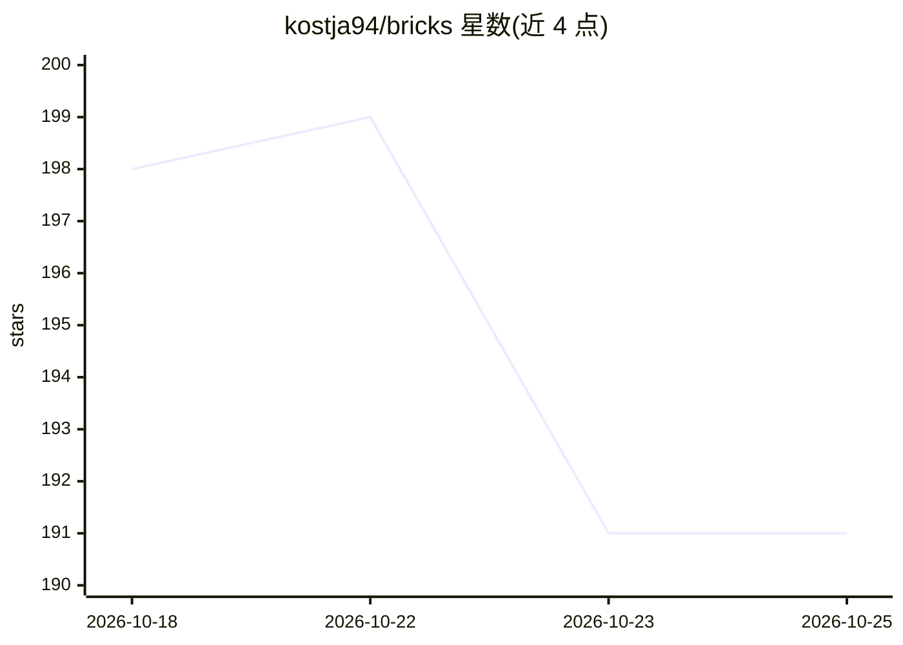

# kostja94/bricks

⭐ 191 · JavaScript · MIT · 推送 2026-09-25 · [GitHub](https://github.com/kostja94/bricks) · [官网](https://alignify.co/products/bricks) · 个人维护

**给编码 agent 的界面组件契约层：让生成组件贴合现有设计系统**

面向 coding agent 的组件构建技能包：以 SKILL.md 与 references 形式为每个组件概念（Footer、FAQ、Agent Workspace 等）提供语义职责、上下文变体、交互状态、技术边界与验证要求的契约。agent 接到组件任务后先读取页面、tokens、依赖与响应式约定，识别组件概念与所有权边界，再复用项目原语实现并在真实页面中验证。附带机器可读目录 catalog/components.json 与 npm 测试校验。明确不提供固定 React/Vue/CSS 组件包，也不替代项目规范。

## 筛选速览

| 维度 | 判定 | 备注 |
|---|---|---|
| AI 角色 | `ai-ecosystem` | LLM/agent 周边工具 |
| 许可风险 | `permissive` | MIT |
| 部署形态 | `library` | 以包/库形式分发 |
| 模型依赖 | — | README 未给出锁定关系 |
| 硬件要求 | — | 无带数字的原话,不猜 |
| 安装摩擦 | `low` | 无编译、无系统依赖或容器化 |
| 成熟度 | — | 结构信号不足 |

## 能力要点

- 每个组件概念维护一份契约：职责、上下文、变体、状态、验证要求
- component-builder 先检查页面/tokens/依赖再实现，复用项目原语
- 机器可读组件目录 catalog/components.json，组件 ID 保持稳定
- 覆盖导航、内容、转化、布局与 Agent 界面五组组件

## 适用场景

- 让编码 agent 在既有设计系统内构建贴合产品的组件
- 避免生成的 Footer/FAQ 出现虚构路由或可访问性缺失
- 为 agent 工具链提供稳定的组件 ID 与质量门

## 场景标签

`编码 Agent` · 领域:编码与开发

## 证据(README 行号)

> L7: Bricks gives coding agents implementation-aware contracts for building interface components that belong in an existi
> L63: The `component-builder` does not begin with a preferred library or visual treatment.

## 星数曲线

2026-10-18 198 → 2026-10-25 191（-7）

---
*卡片 v1 · prompt 1.4 · 生成 2026-10-22 · 置信度 high · 依据 README sha `c37504ac891b` · [字段定义](../../DATASET.md)*
