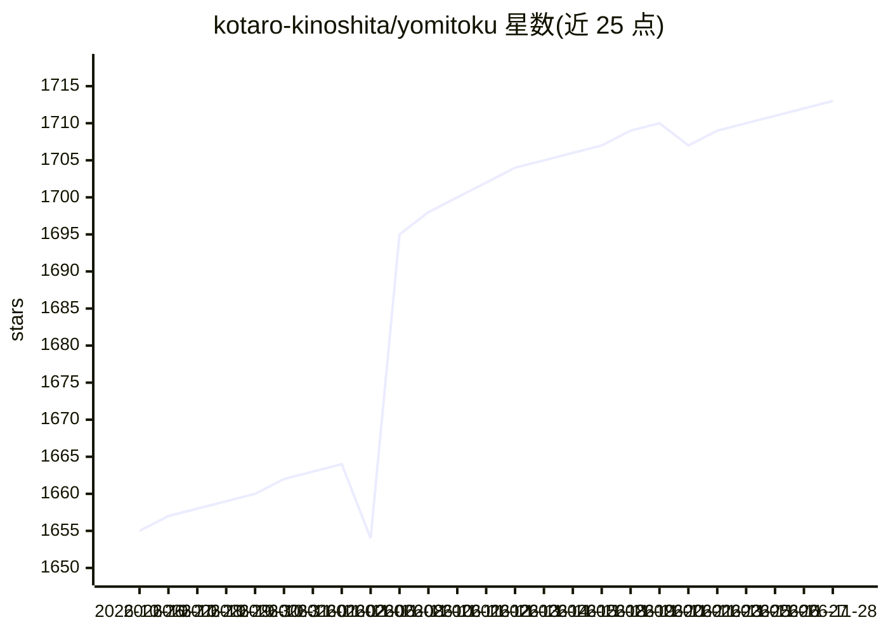

# kotaro-kinoshita/yomitoku

⭐ 1,713 · Python · 推送 2026-11-19 · [GitHub](https://github.com/kotaro-kinoshita/yomitoku) · [官网](https://kotaro-kinoshita.github.io/yomitoku/) · 个人维护

**面向日语文档图像的 OCR 与版面解析 Python 包**

YomiToku 是针对日语的文档图像分析（Document AI）包：内置四个自训练模型（文字检测、文字识别、版面解析、表格结构识别），支持 7000+ 日文字符、手写与竖排文档。处理流程含可选几何校正（--dewarp）、OCR、版面解析与阅读顺序估计，输出 html/markdown/json/csv 与可检索 PDF。通过 pip 安装，提供 CLI 与 Python API；源代码与模型权重为 CC BY-NC-SA 4.0，商业使用需购买产品版许可。

## 筛选速览

| 维度 | 判定 | 备注 |
|---|---|---|
| AI 角色 | `ai-native` | 本体是模型或模型工具 |
| 许可风险 | `none` | — |
| 部署形态 | `self-host` | docker 或自建部署 |
| 模型依赖 | local-ok | 支持本地模型 |
| 硬件要求 | `gpu-8g` | |
| 安装摩擦 | `low` | 无编译、无系统依赖或容器化 |
| 成熟度 | — | 结构信号不足 |

## 能力要点

- 四个自训练模型：文字检测、文字识别、版面解析、表格结构识别
- 输出 html/markdown/json/csv 及可检索 PDF，支持图表提取
- --dewarp 页面检测与非线性几何校正预处理
- 轻量模型（--lite）支持 CPU 推理，VRAM 8GB 以内运行

## 适用场景

- 日文扫描文档转 markdown 或可检索 PDF
- 从帳票图片提取表格的 Key-Value 与网格结构
- 按 YAML schema 从表单图像抽取结构化字段
- 手机拍摄的弯曲/倾斜文档校正后解析

## 场景标签

`OCR` `文档解析` · 领域:知识与检索

## 证据(README 行号)

> L16: YomiToku は日本語に特化した AI 文章画像解析エンジン(Document AI)です。画像内の文字の全文 OCR およびレイアウト解析機能を有しており、画像内の文字情報や図表を認識、抽出、変換します。
> L18: - 🤖 日本語データセットで学習した 4 種類(文字位置の検知、文字列認識、レイアウト解析、表の構造認識)の AI モデルを搭載しています。4 種類のモデルはすべて独自に学習されたモデルで日本語文書に対して、高精度に推論可能です。
> L22: - ⚡ GPU 環境で高速に動作し、効率的に文書の文字起こし解析が可能です。また、VRAM も 8GB 以内で動作し、ハイエンドな GPU を用意する必要はありません。軽量モデルを用いれば CPU でも高速に推論が可能です。

## 星数曲线

2026-10-26 1,655 → 2026-11-28 1,713（+58）

---
*卡片 v1 · prompt 1.4 · 生成 2026-11-23 · 置信度 mid · 依据 README sha `1542223f8cd9` · [字段定义](../../DATASET.md)*
