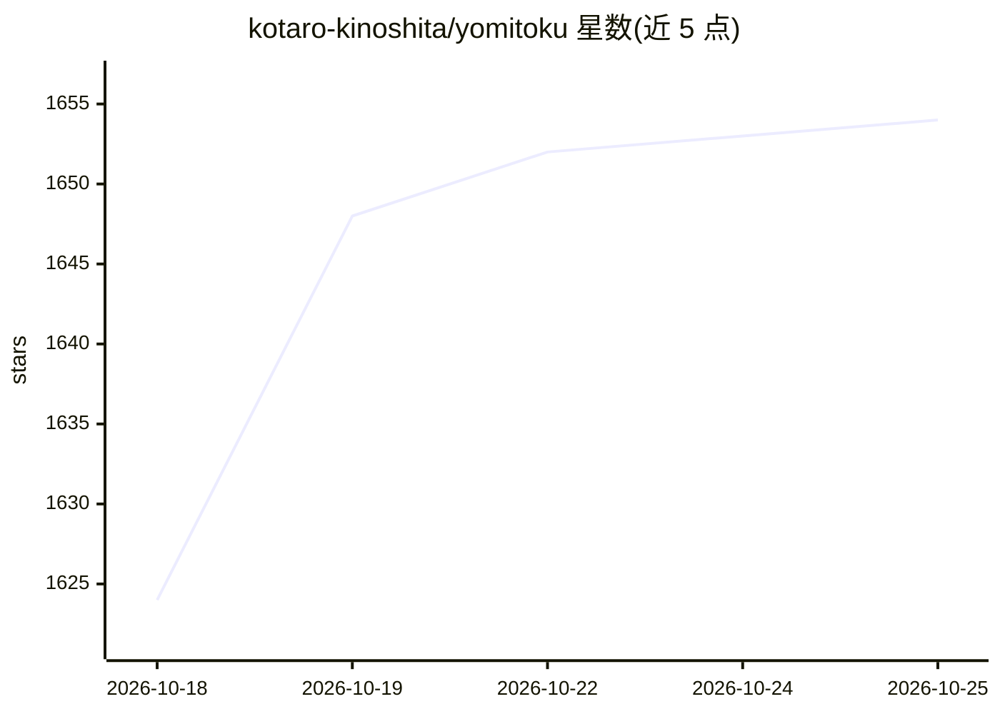

# kotaro-kinoshita/yomitoku

⭐ 1,655 · Python · 推送 2026-10-22 · [GitHub](https://github.com/kotaro-kinoshita/yomitoku) · [官网](https://kotaro-kinoshita.github.io/yomitoku/) · 组织维护

**日本語特化の文書画像 AI 解析引擎：OCR 与布局/表格解析**

面向日语文档图像的 Document AI Python 包：内置文字检测、文字识别、版面分析、表格结构识别 4 个在日语数据集上训练的模型，支持 7000+ 日语字符、手写与竖排，兼用英语。提供全文 OCR、阅读顺序估计、图/表/图像抽取，输出 md/html/json/csv 与可搜索 PDF；另有表语义解析（Key-Value/网格）与基于 YAML 模式的结构化数据抽取（规则式与 LLM 式，后者可配 vLLM）。GPU 推荐 VRAM 8GB 以内，轻量模型可在 CPU 运行；浏览器版 YomiToku Studio 全部本地推理。源码与模型权重采用 CC BY-NC-SA 4.0，商用需另购许可。

## 筛选速览

| 维度 | 判定 | 备注 |
|---|---|---|
| AI 角色 | `ai-native` | 本体是模型或模型工具 |
| 许可风险 | `none` | — |
| 部署形态 | `self-host` | docker 或自建部署 |
| 模型依赖 | local-ok | 支持本地模型 |
| 硬件要求 | `gpu-8g` | |
| 安装摩擦 | `low` | 无编译、无系统依赖或容器化 |
| 成熟度 | — | 结构信号不足 |

## 能力要点

- 4 种日语数据集自训模型（检测/识别/版面/表格结构）
- 输出 md/html/json/csv/可搜索 PDF，可抽取图表图像
- Table Semantic Parser 与 YAML 模式结构化抽取（规则式/LLM 式）
- 浏览器版 Studio 以 WebAssembly/WebGPU 全本地推理

## 适用场景

- 把日语扫描文档/图片转成 Markdown 或可搜索 PDF
- 从帳票中抽取 Key-Value 或网格表格数据
- 没有高端 GPU 时用轻量模型在 CPU 上做 OCR

## 场景标签

`OCR` `文档解析` · 领域:知识与检索

## 证据(README 行号)

> L16: YomiToku は日本語に特化した AI 文章画像解析エンジン(Document AI)です。画像内の文字の全文 OCR およびレイアウト解析機能を有しており、画像内の文字情報や図表を認識、抽出、変換します。
> L18: - 🤖 日本語データセットで学習した 4 種類(文字位置の検知、文字列認識、レイアウト解析、表の構造認識)の AI モデルを搭載しています。4 種類のモデルはすべて独自に学習されたモデルで日本語文書に対して、高精度に推論可能です。

## 星数曲线

2026-10-18 1,624 → 2026-10-25 1,654（+30）

---
*卡片 v1 · prompt 1.4 · 生成 2026-10-21 · 置信度 mid · 依据 README sha `ddf532038870` · [字段定义](../../DATASET.md)*
