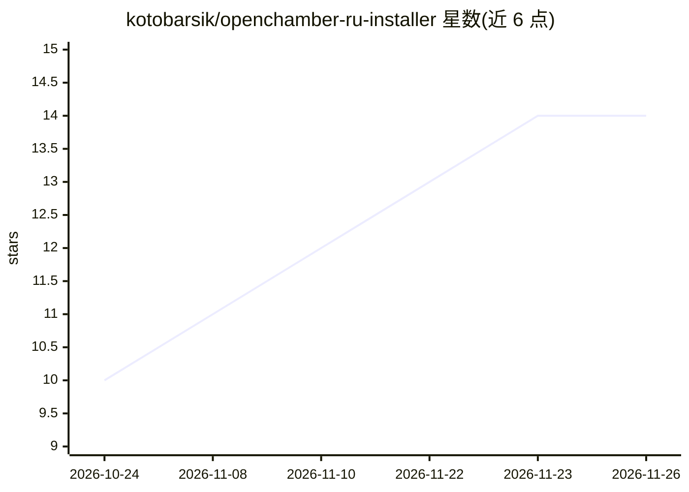

# kotobarsik/openchamber-ru-installer

⭐ 14 · TypeScript · 推送 2026-11-20 · [GitHub](https://github.com/kotobarsik/openchamber-ru-installer) · 个人维护

**为 OpenChamber Desktop 安装俄语界面翻译的 Windows 脚本**

面向 Windows 桌面版 OpenChamber（Electron 应用）的俄语翻译安装器：通过 PowerShell 一行命令或本地脚本运行，自动定位已安装的应用路径，备份原始文件（.bak），从 i18n 源文件生成俄语语言包 chunk 并补丁 i18n 核心与 locale 映射，同时向 14 个其他语言词典写入语言标签。安装前检测运行中的应用，按版本戳 .ru-patch.json 处理升级残留，出错时自动回滚；提供 uninstall 脚本完整恢复原文件。支持 v1.14.1–v2.6.1 多个版本。

## 筛选速览

| 维度 | 判定 | 备注 |
|---|---|---|
| AI 角色 | `ai-enhanced` | 去掉 AI 部分产品仍成立 |
| 许可风险 | `none` | — |
| 部署形态 | `None` |  |
| 模型依赖 | — | README 未给出锁定关系 |
| 硬件要求 | — | 无带数字的原话,不猜 |
| 安装摩擦 | `low` | 无编译、无系统依赖或容器化 |
| 成熟度 | — | 结构信号不足 |

## 能力要点

- PowerShell 一行命令联网安装，重复运行即更新翻译
- 自动备份 .bak 并支持卸载完整还原原始文件
- 按文件内容定位补丁锚点，覆盖 16 个已测试版本
- 安装结果校验，任一步出错自动回滚

## 适用场景

- 给 Windows 上的 OpenChamber Desktop 加上俄语界面
- OpenChamber 官方更新后重新安装翻译
- 以脚本参数与环境变量批量自动化部署/卸载翻译

## 场景标签

 · 领域:软件本地化/桌面工具

## 证据(README 行号)

> L1: # Установщик русского перевода для OpenChamber Desktop
> L56: - Генерирует чанк `ru-<hash>.js` из `i18n/messages/ru.ts` и `i18n/messages/ru.settings.ts`.
> L83: ## Совместимость

## 星数曲线

2026-10-24 10 → 2026-11-26 14（+4）

---
*卡片 v1 · prompt 1.4 · 生成 2026-11-18 · 置信度 high · 依据 README sha `5eb2bf530296` · [字段定义](../../DATASET.md)*
