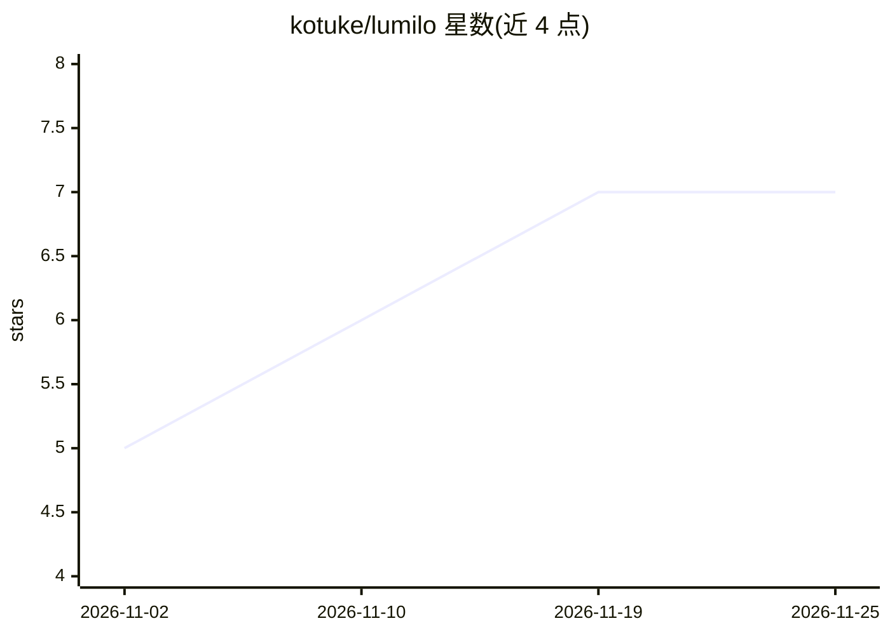

# kotuke/lumilo

⭐ 7 · Go · MIT · 推送 2026-11-09 · [GitHub](https://github.com/kotuke/lumilo) · 个人维护

**macOS 菜单栏面板：管理本地 LLM 引擎的运行与监控**

面向 Mac 用户（Apple silicon）的菜单栏应用，替用户启动和停止本地 LLM 推理引擎（Splash、llama.cpp、TensorFold），显示内存占用、每秒 token 数、首 token 时间等指标，从 Hugging Face 搜索并下载模型，并可一键把 Claude Code、Codex 等编码代理指向本地服务器。服务器默认仅监听本机，网络访问需存于 Keychain 的 API key。通过 Homebrew cask 或 dmg 安装，应用自身支持自动更新。

## 筛选速览

| 维度 | 判定 | 备注 |
|---|---|---|
| AI 角色 | `ai-ecosystem` | LLM/agent 周边工具 |
| 许可风险 | `permissive` | MIT |
| 部署形态 | `desktop` | 安装包/桌面程序 |
| 模型依赖 | local-ok | 支持本地模型 |
| 硬件要求 | — | 无带数字的原话,不猜 |
| 安装摩擦 | `medium` | 含编译或系统依赖之一 |
| 成熟度 | — | 结构信号不足 |

## 能力要点

- 一键启动/停止 llama.cpp（llama-server）、Splash、TensorFold 服务器
- 菜单栏实时显示内存、token 速度与最近 20 次请求图表
- Hugging Face 模型搜索、下载（支持断点续传）与按内存适配性提示
- 一键将 Claude Code/Codex/OpenCode/Pi 指向本地服务器

## 适用场景

- 在 Mac 上无终端操作本地 LLM 服务器
- 下载和管理 Hugging Face 上的 GGUF/MLX 模型
- 让编码代理使用本地推理服务
- 监控本地模型的内存与生成速度

## 场景标签

`推理引擎` · 领域:训练与推理

## 证据(README 行号)

> L5: **A menu-bar panel for the LLM engines on your Mac.**
> L20: TensorFold for you.
> L24: Settings. Engines are pluggable; mlx-serve and

## 星数曲线

2026-11-02 5 → 2026-11-25 7（+2）

---
*卡片 v1 · prompt 1.4 · 生成 2026-11-20 · 置信度 high · 依据 README sha `e740d8e6026f` · [字段定义](../../DATASET.md)*
