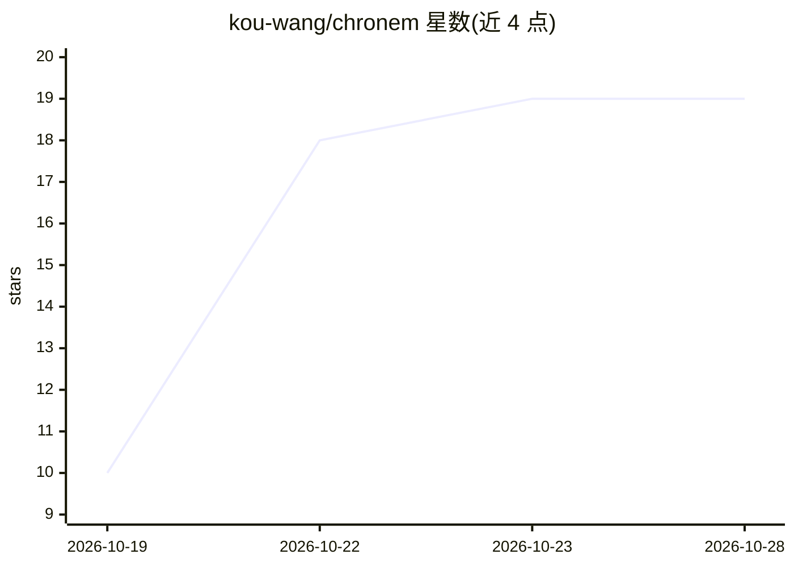

# kou-wang/chronem

⭐ 19 · Python · Apache-2.0 · 推送 2026-10-13 · [GitHub](https://github.com/kou-wang/chronem) · 个人维护

**为 AI 应用提供带生命周期与溯源的时序记忆引擎**

开源 Python 库，把自然语言捕获转成结构化、带生命周期管理的记忆：五种记忆类型（FACT/PREFERENCE/CURRENT_STATE/EVENT/INTENT），确定性生命周期引擎决定持久化与状态取代，保留历史与来源溯源，召回路径可在证据不足时拒绝作答。LLM 仅用于解释语言，不决定持久化。支持 PostgreSQL 持久化与可选 OpenAI 适配器，核心示例无需 API key；语义/向量检索尚未实现，自述为早期阶段。

## 筛选速览

| 维度 | 判定 | 备注 |
|---|---|---|
| AI 角色 | `ai-ecosystem` | LLM/agent 周边工具 |
| 许可风险 | `permissive` | Apache-2.0 |
| 部署形态 | `self-host` | docker 或自建部署 |
| 模型依赖 | — | README 未给出锁定关系 |
| 硬件要求 | — | 无带数字的原话,不猜 |
| 安装摩擦 | `low` | 无编译、无系统依赖或容器化 |
| 成熟度 | `idea` | |

## 能力要点

- 确定性生命周期引擎（APPEND/NOOP/SUPERSEDE）无需模型或网络调用
- 五种记忆类型与来源溯源、引用校验的 grounded 回答
- PostgreSQL 持久化与可选 OpenAI 适配器，快速上手无需 API key 或数据库
- CI 运行确定性契约评估，失败即门禁关闭

## 适用场景

- 为 AI agent 添加带状态变更历史的长期记忆
- 需要保留证据与时间线的结构化记忆存储
- 召回结果需可溯源、可拒绝作答的问答系统

## 场景标签

`Agent 记忆` · 领域:Agent 开发

## 证据(README 行号)

> L5: Chronem is an open-source temporal memory engine for AI applications. It turns
> L27: Chronem is an engine rather than a notes app or a complete assistant. Applications
> L28: provide their own interface and may plug model providers into the interpretation

## 星数曲线

2026-10-19 10 → 2026-10-28 19（+9）

---
*卡片 v1 · prompt 1.4 · 生成 2026-10-28 · 置信度 mid · 依据 README sha `7b1b36cd09e8` · [字段定义](../../DATASET.md)*
