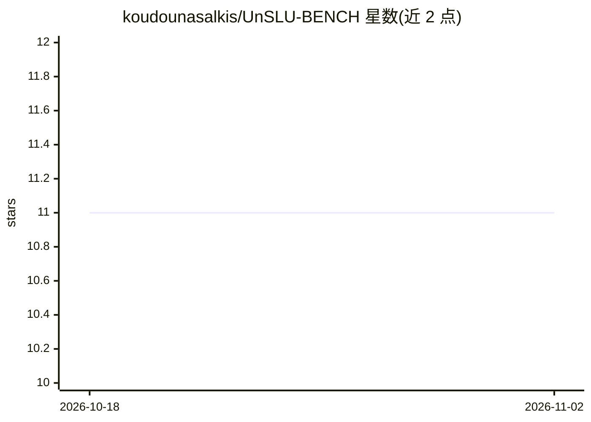

# koudounasalkis/UnSLU-BENCH

⭐ 11 · Jupyter Notebook · Apache-2.0 · 推送 2026-05-25 · [GitHub](https://github.com/koudounasalkis/UnSLU-BENCH) · 组织维护

**语音理解机器遗忘基准：多语言数据集与方法评测结果**

配套 INTERSPEECH 2025 论文与 TASLP 期刊扩展版的机器遗忘基准仓库：在 FSC、SLURP、ITALIC、SpeechMASSIVE（德/法）多语言语音理解数据集上，对 FT、NG、NG+、CF-k、UNSIR、BT、BT-L、SCRUB 等遗忘方法进行评测，模型覆盖 wav2vec 2.0、HuBERT、XLS-R-128/XLS-R-53；提供数据集构建 notebook 与 GUM/CGUM 指标实现（推荐使用更新后的 CGUM），并列出各方法最优学习率。实验在两块 NVIDIA A6000 48GB GPU 上完成。

## 筛选速览

| 维度 | 判定 | 备注 |
|---|---|---|
| AI 角色 | `ai-ecosystem` | LLM/agent 周边工具 |
| 许可风险 | `permissive` | Apache-2.0 |
| 部署形态 | `None` |  |
| 模型依赖 | — | README 未给出锁定关系 |
| 硬件要求 | — | 无带数字的原话,不猜 |
| 安装摩擦 | `low` | 无编译、无系统依赖或容器化 |
| 成熟度 | — | 结构信号不足 |

## 能力要点

- 覆盖 4 个数据集、8 种机器遗忘方法的完整评测结果表
- 提供 GUM 及更新版 CGUM 指标实现（CGUM.ipynb）
- 含数据集构建 notebook（unlearning_datasets_creation）
- 列出各方法在每组合下的最优学习率

## 适用场景

- 比较机器遗忘方法在语音理解任务上的表现
- 复现论文实验或获取基准数据集构建流程
- 查找遗忘方法的最优超参数配置

## 场景标签

`模型评测` · 领域:评测与运维

## 证据(README 行号)

> L4: This repository contains the detailed experimental results for the paper **"Alexa, can you *forget* me?” Machine Unl
> L25: **Datasets.** It is possible to obtain the datasets used in the experiments by running the relative notebooks prese

## 星数曲线

2026-10-18 11 → 2026-11-02 11（+0）

---
*卡片 v1 · prompt 1.4 · 生成 2026-11-02 · 置信度 high · 依据 README sha `314090ba13b1` · [字段定义](../../DATASET.md)*
