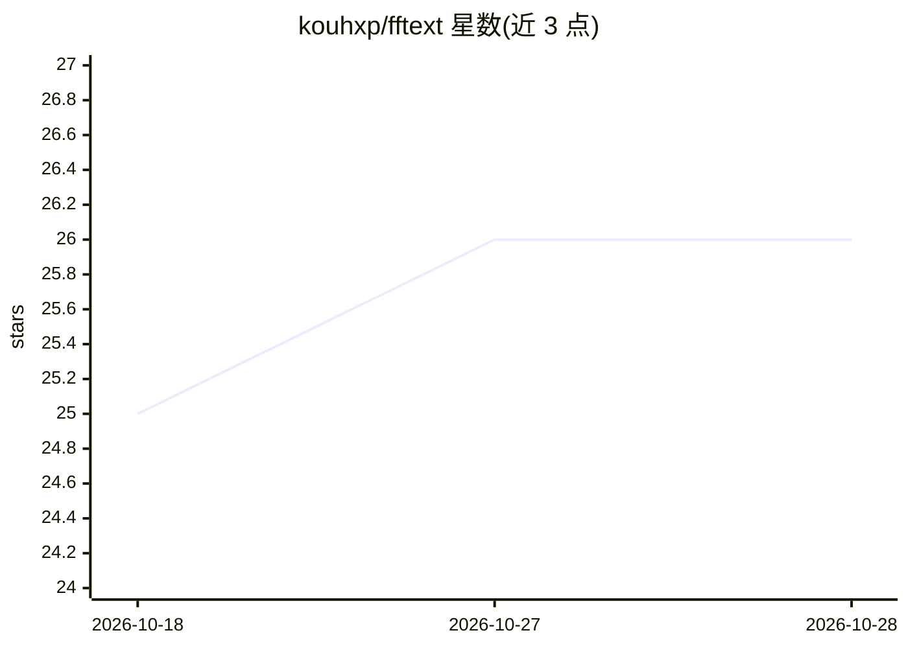

# kouhxp/fftext

⭐ 26 · Python · Apache-2.0 · 推送 2026-06-15 · [GitHub](https://github.com/kouhxp/fftext) · 个人维护

**CPU 本地跑小模型，一句话总结/解释/事实核查/翻译任意文本**

Python CLI 工具，内置量化 0.8B Qwen3.5（GGUF，约 500 MB）经 llama.cpp 在纯 CPU 上推理，提供四个子命令：summarize（三条要点）、explain（ELI5）、check（抽取声明→Mojeek/Startpage 网络搜索→标注 SUPPORTED/REFUTED/CONFLICTING/INSUFFICIENT 并附来源 URL）、translate（--lang 自由描述目标语言）。输入支持文件/URL/原始字符串与 stdin，长文截断到约 1 万字符、上下文固定 4,096 token。首次运行下载模型，之后离线（check 需联网）。限制：小模型对边缘声明可能幻觉、小语种翻译退化、URL 解析对文档页/SPA 效果有限。

## 筛选速览

| 维度 | 判定 | 备注 |
|---|---|---|
| AI 角色 | `ai-native` | 本体是模型或模型工具 |
| 许可风险 | `permissive` | Apache-2.0 |
| 部署形态 | `library` | 以包/库形式分发 |
| 模型依赖 | local-ok | 支持本地模型 |
| 硬件要求 | `cpu-ok` | |
| 安装摩擦 | `medium` | 含编译或系统依赖之一 |
| 成熟度 | — | 结构信号不足 |

## 能力要点

- 四任务四提示词：总结/ELI5 解释/带引用的事实核查/自由语言翻译
- 纯 CPU 本地推理，无需 GPU/API key，流式输出
- check 流程：抽声明→LLM 排序→关键词改写→双搜索引擎轮换→带来源 URL 的四标签裁决
- 换用其他 GGUF 模型需改 llm.py 源码，模板按 Qwen 聊天格式调优

## 适用场景

- 本地无网络环境下快速总结文章或文件
- 对文本声明做带引用来源的事实核查
- 把文档翻译成自定义语言与语域
- 作为 Unix 管道过滤器处理 stdin 文本

## 场景标签

`AI 写作` · 领域:内容生成

## 证据(README 行号)

> L19: - ⚡ **Fast on CPU.** Powered by a quantized 0.8B Qwen3.5 (Q4_K_M GGUF, ~500 MB) running through `llama.cpp`. Stream
> L25: - 🔍 **Fact-check with citations.** `fftext check` extracts claims, ranks them, web-searches each one (Mojeek and St
> L44: |`check`|`c`|Extract claims → web-search each → label SUPPORTED / REFUTED / CONFLICTING / INSUFFICIENT.|

## 星数曲线

2026-10-18 25 → 2026-10-28 26（+1）

---
*卡片 v1 · prompt 1.4 · 生成 2026-10-27 · 置信度 high · 依据 README sha `49c2f8ad8daf` · [字段定义](../../DATASET.md)*
