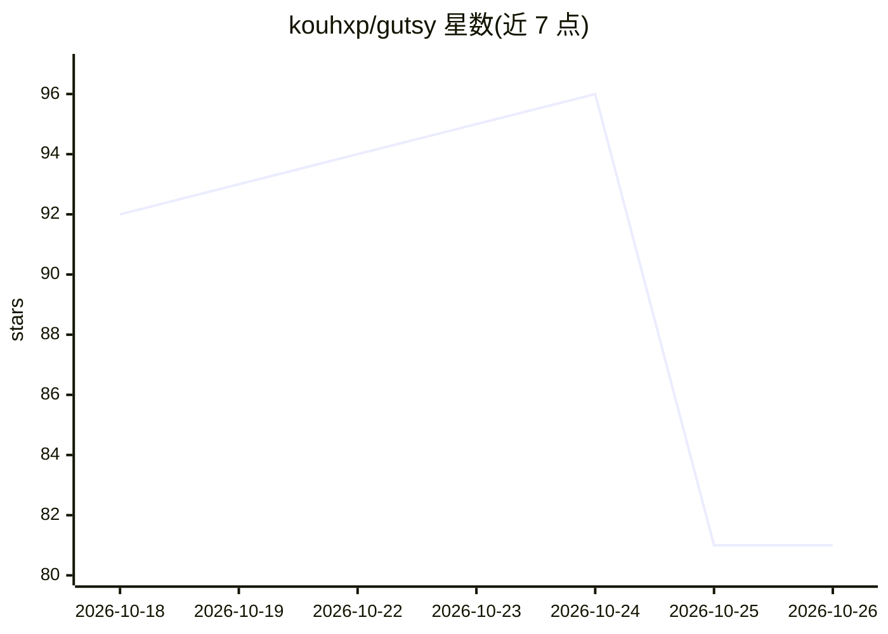

# kouhxp/gutsy

⭐ 81 · HTML · Apache-2.0 · 推送 2026-10-05 · [GitHub](https://github.com/kouhxp/gutsy) · 个人维护

**本地决策模型：发状态与问题，返回各选项的校准概率**

gutsy 提供 0.8B 参数（Qwen3.5-0.8B 微调）的本地决策模型，GGUF 格式（Q8_0 775MB / Q4_K_M 505MB），经 llama.cpp 在普通 CPU 上运行。API 遵循 Jev 风格的 Decisions 格式，发送状态文本或 JSON 与是/否、选择、打分类型问题，返回每个选项的概率，不做文本生成、无网络调用。支持至多 255 个选项并返回 reject 概率；确定性输出、验证集校准误差 0.022。README 同时列出弱点：日期数字运算接近随机、仅英语、CPU 长状态推理中位数 4.3 秒。

## 筛选速览

| 维度 | 判定 | 备注 |
|---|---|---|
| AI 角色 | `ai-native` | 本体是模型或模型工具 |
| 许可风险 | `permissive` | Apache-2.0 |
| 部署形态 | `library` | 以包/库形式分发 |
| 模型依赖 | — | README 未给出锁定关系 |
| 硬件要求 | `cpu-ok` | |
| 安装摩擦 | `low` | 无编译、无系统依赖或容器化 |
| 成熟度 | — | 结构信号不足 |

## 能力要点

- 是/否、选择、打分问题的校准概率输出，无文本生成与按次费用
- GGUF Q8_0/Q4_K_M 在普通 CPU 上经 llama.cpp 运行
- Jev 风格 Decisions API，现有客户端多数仅需更换 base URL
- 支持至多 255 个选项并附带 reject 概率

## 适用场景

- 客服工单分类与退款/更换/升级决策打分
- 对 30 行反馈表逐行回答是/否问题
- 为每条消息选择最便宜模型的模型路由
- 销售通话中的实时触发判定

## 场景标签

 · 领域:LLM/决策与分类

## 证据(README 行号)

> L3: **Local decision models with calibrated probabilities.** Send a state (text or JSON) and typed
> L4: questions (yes/no, choice, score); get a probability for every option back. No text generation, no
> L18: - **Local and private.** Runs on CPU; your data never leaves the machine.

## 星数曲线

2026-10-18 92 → 2026-10-26 81（-11）

---
*卡片 v1 · prompt 1.4 · 生成 2026-10-23 · 置信度 high · 依据 README sha `39a9e541e800` · [字段定义](../../DATASET.md)*
