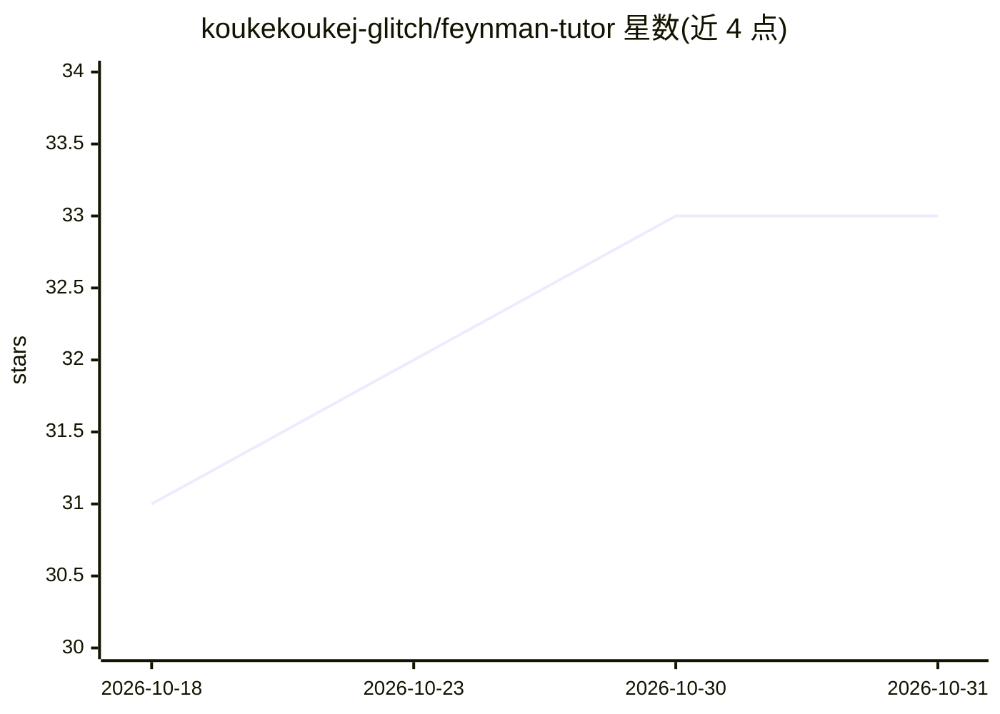

# koukekoukej-glitch/feynman-tutor

⭐ 33 · Python · MIT · 推送 2026-05-18 · [GitHub](https://github.com/koukekoukej-glitch/feynman-tutor) · 个人维护 · 中文 README

**基于费曼学习法的 AI 教学 Skill：让用户讲解、暴露盲点**

面向 Claude Code 及任何支持自定义 System Prompt + 文件读写 + Shell 执行的 LLM Agent 框架的教学技能。核心机制为角色反转：用户扮演老师讲解概念，Skill 通过递进追问定位认知边界（ZPD），不直接给答案，并输出分级诊断反馈。支持从 YouTube/B站/微信公众号/PDF/arXiv 等来源自动提取教学素材，通过 notes/ 目录跨会话持久化主题笔记、学习者模型与认知地图。材料提取需 Python 3.10+，核心逻辑为纯 Markdown 指令，MIT 许可。

## 筛选速览

| 维度 | 判定 | 备注 |
|---|---|---|
| AI 角色 | `ai-native` | 本体是模型或模型工具 |
| 许可风险 | `permissive` | MIT |
| 部署形态 | `None` |  |
| 模型依赖 | — | README 未给出锁定关系 |
| 硬件要求 | — | 无带数字的原话,不猜 |
| 安装摩擦 | `low` | 无编译、无系统依赖或容器化 |
| 成熟度 | — | 结构信号不足 |

## 能力要点

- 角色反转教学：用户讲解、通过追问暴露知识盲点
- 三层跨会话记忆（主题笔记/学习者模型/认知地图）
- 多源材料提取：YouTube/B站/微信公众号/PDF/arXiv/网页/X
- 分级诊断反馈（关键误解/理解不完整/表述可优化）

## 适用场景

- 通过给 AI 讲解概念发现自己没真正理解的地方
- 把 YouTube 视频或 arXiv 论文转化为费曼式学习素材
- 跨会话持续跟踪学习进度与认知盲区

## 场景标签

`提示工程` · 领域:Agent 开发

## 证据(README 行号)

> L3: 基于费曼学习法的 AI 教学 Skill。通过角色反转让用户主动讲解概念，在讲不清楚的地方定位知识盲点，在认知边界上精准施教。
> L11: - **角色反转教学** — 用户扮演"老师"讲解概念，Skill 通过追问暴露知识盲点，不直接给答案
> L125: **只能在 Claude Code 里用？** 核心逻辑是纯 Markdown 指令，任何支持文件读写和 Shell 的 Agent 框架都可适配。

## 星数曲线

2026-10-18 31 → 2026-10-31 33（+2）

---
*卡片 v1 · prompt 1.4 · 生成 2026-10-26 · 置信度 high · 依据 README sha `349b0361fe9c` · [字段定义](../../DATASET.md)*
