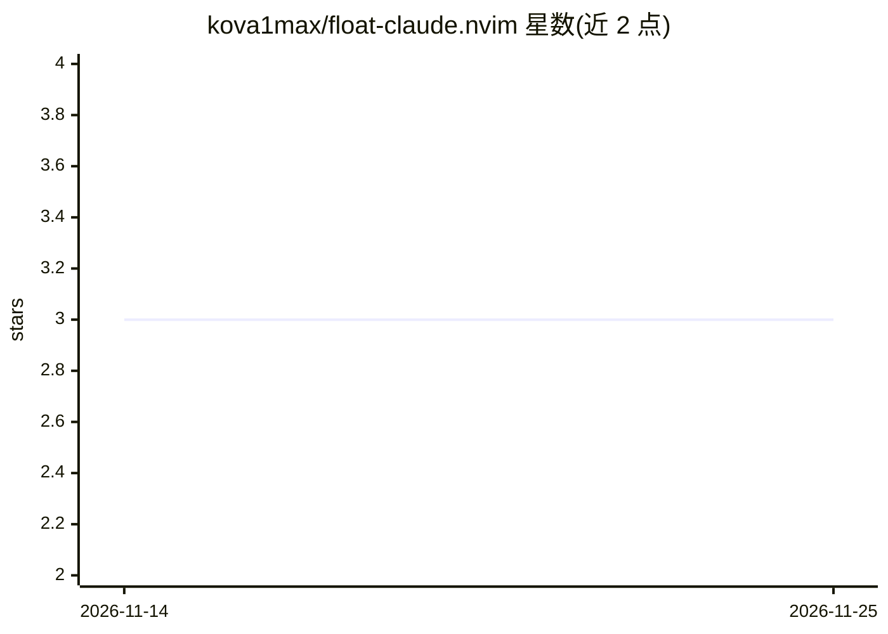

# kova1max/float-claude.nvim

⭐ 3 · Lua · MIT · 推送 2026-11-06 · [GitHub](https://github.com/kova1max/float-claude.nvim) · 个人维护

**Neovim 插件：选中代码即可向 Claude Code CLI 提问或改写**

纯 Lua 编写的 Neovim 插件，零依赖。用户选中代码后按键唤起光标附近的浮动弹窗，向 `claude` CLI 发送问题或改写请求：回答流式显示，编辑则逐行重写选中区域（可撤销，或先以 diff 形式审阅）。每次追问重发当前代码及变更 diff，支持最多 5 个并发会话、`@` 文件/诊断提及、LSP 定义跳转、treesitter 高亮与 9 套主题。运行依赖 PATH 中的 `claude` CLI 登录，无 API key 也可用 Claude 订阅。

## 筛选速览

| 维度 | 判定 | 备注 |
|---|---|---|
| AI 角色 | `ai-native` | 本体是模型或模型工具 |
| 许可风险 | `permissive` | MIT |
| 部署形态 | `None` |  |
| 模型依赖 | locked-api |  |
| 硬件要求 | — | 无带数字的原话,不猜 |
| 安装摩擦 | `low` | 无编译、无系统依赖或容器化 |
| 成熟度 | — | 结构信号不足 |

## 能力要点

- 选中代码一键提问或原地改写，编辑以 diff 审阅后接受/丢弃
- 无需 API key：复用已登录的 claude CLI（订阅或 Bedrock/Vertex 环境配置）
- 追问自动携带最新代码与双方变更 diff，可定位到会话内代码定义
- 纯 Lua 零依赖，CLI 无工具/MCP/hooks 权限，仅改动选中行

## 适用场景

- 在 Neovim 里对选中函数提问时间复杂度、类型等问题
- 让 AI 就地重构选中代码并用 diff 审阅后接受
- 一键执行解释、修诊断、生成测试/文档注释等动作
- SSH/tmux 终端环境下使用 AI 编码辅助

## 场景标签

`编码 Agent` · 领域:编码与开发

## 证据(README 行号)

> L3:  Select code, press a key, ask Claude. A tiny popup answers, or rewrites the selection in place, with your Claude Co
> L12: - **No API key.** It runs the `claude` CLI you are already signed in to, so replies come out of your Claude Code su
> L22: - **Claude Code**: the `claude` CLI on your `PATH`, signed in (run `claude` once in a terminal).

## 星数曲线

2026-11-14 3 → 2026-11-25 3（+0）

---
*卡片 v1 · prompt 1.4 · 生成 2026-11-21 · 置信度 high · 依据 README sha `d408e04f3ac7` · [字段定义](../../DATASET.md)*
