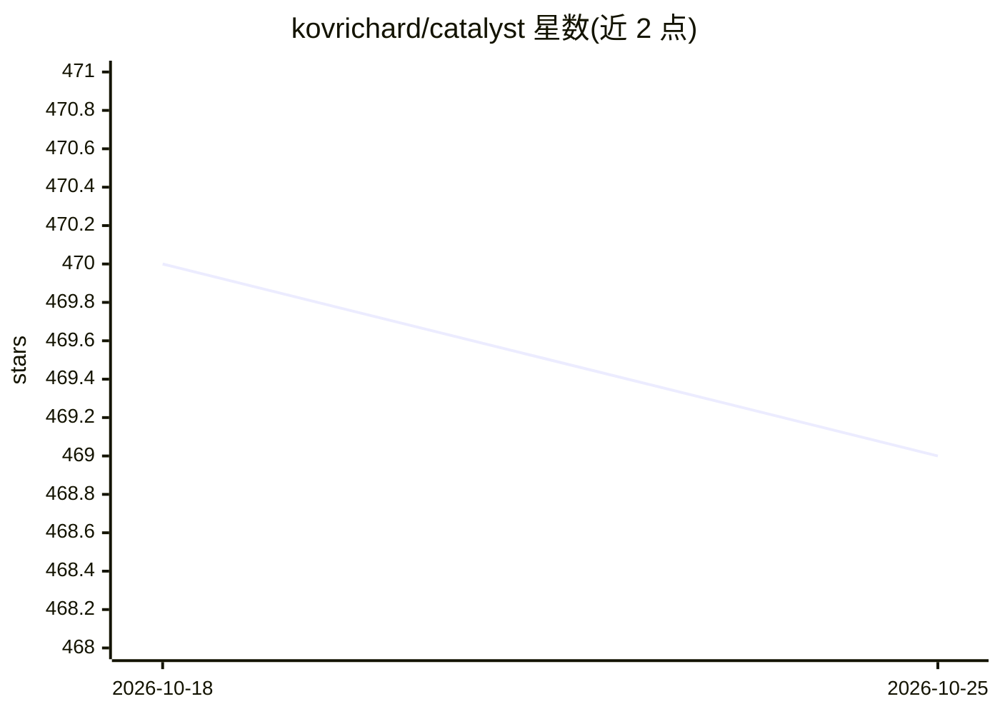

# kovrichard/catalyst

⭐ 469 · TypeScript · 推送 2026-09-29 · [GitHub](https://github.com/kovrichard/catalyst) · [官网](https://catalyst.konvert7.com) · 个人维护

**面向 AI agent 的 Next.js 全栈启动模板：自检 agent 输出并内置 MCP 服务器**

基于 Next.js、Bun、Prisma、tRPC、Better Auth、Stripe、S3、Redis 等技术栈的全栈 Web 应用模板，面向开发者。特色机制：agent 停止时自动运行 Biome、tsc、knip、klint 等 8 项检查并将失败原因回传给 agent；klint 把 AGENTS.md 中的架构规则转为构建失败；内置只读 MCP 服务器（/api/mcp，API key 鉴权、限流、字段白名单、4 个查询工具）。兼容 Claude Code、Cursor、Codex、OpenCode，可用 bun run configure 按需移除不需要的模块，支持 Docker 运行。

## 筛选速览

| 维度 | 判定 | 备注 |
|---|---|---|
| AI 角色 | `ai-ecosystem` | LLM/agent 周边工具 |
| 许可风险 | `none` | — |
| 部署形态 | `self-host` | docker 或自建部署 |
| 模型依赖 | — | README 未给出锁定关系 |
| 硬件要求 | — | 无带数字的原话,不猜 |
| 安装摩擦 | `low` | 无编译、无系统依赖或容器化 |
| 成熟度 | — | 结构信号不足 |

## 能力要点

- agent 停止时自动运行 8 项代码检查并把失败原因回传给 agent
- klint 将 AGENTS.md 架构规则转为构建失败
- 只读 MCP 服务器：API key 鉴权、按 key 限流、模型/字段白名单
- bun run configure 可移除 auth/数据库/邮件/MCP/Redis/Stripe 等模块

## 适用场景

- 我想快速起一个带认证、支付、存储的全栈 Next.js 项目
- 让我的 AI 编码 agent 在提交前自动过代码检查
- 通过 MCP 让外部 agent 只读查询我托管的数据库

## 场景标签

 · 领域:Web 开发/脚手架

## 证据(README 行号)

> L21: **One setup, every agent.** AGENTS.md, the hooks, and the skills work in Claude Code, Cursor,
> L24: **Agent-ready from day one.** A read-only MCP server at `/api/mcp` with API keys, per-key rate
> L145: Catalyst exposes a read-only MCP server at `POST /api/mcp`, so external agents can query your hosted database dire

## 星数曲线

2026-10-18 470 → 2026-10-25 469（-1）

---
*卡片 v1 · prompt 1.4 · 生成 2026-10-21 · 置信度 high · 依据 README sha `988b956786b9` · [字段定义](../../DATASET.md)*
