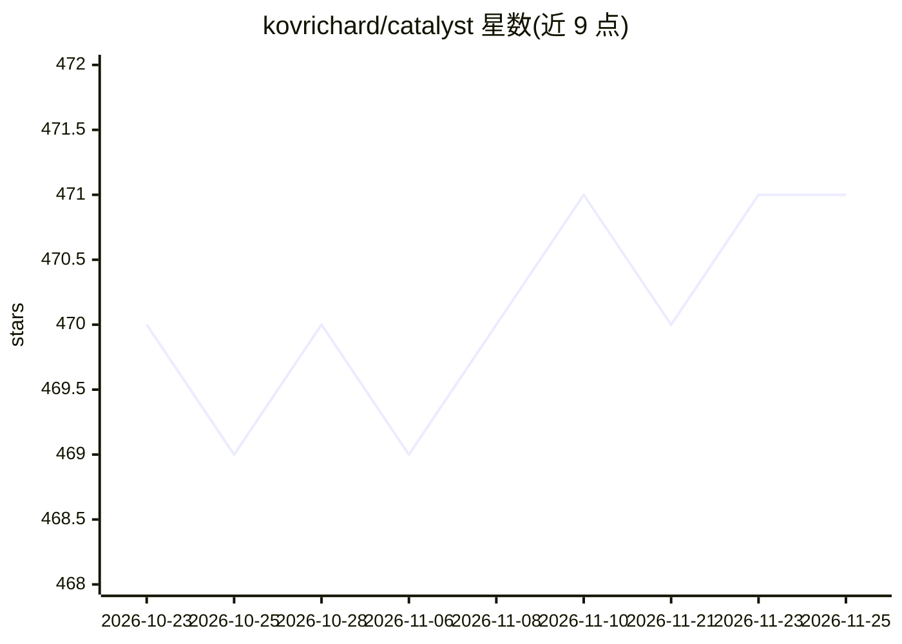

# kovrichard/catalyst

⭐ 471 · TypeScript · 推送 2026-11-19 · [GitHub](https://github.com/kovrichard/catalyst) · [官网](https://catalyst.konvert7.com) · 个人维护

**面向开发者的 Next.js 脚手架，内置 agent 自检与只读 MCP 服务**

一个 Next.js 起步模板：内置认证（Better Auth）、Prisma/PostgreSQL 数据库、Stripe 支付、S3 文件存储、Redis、tRPC、SEO 配置与 GitHub Actions CI。AI 相关机制包括：agent 停止时自动运行九项检查（Biome、tsc、knip 等）并把失败原因回传给 agent；AGENTS.md 中的架构规则经 klint 转为构建失败；在 /api/mcp 提供带 API key、速率限制与字段白名单的只读 MCP 服务器，供外部 agent 查询数据库。支持通过 bun run configure 移除不需要的功能模块。

## 筛选速览

| 维度 | 判定 | 备注 |
|---|---|---|
| AI 角色 | `ai-enhanced` | 去掉 AI 部分产品仍成立 |
| 许可风险 | `none` | — |
| 部署形态 | `self-host` | docker 或自建部署 |
| 模型依赖 | — | README 未给出锁定关系 |
| 硬件要求 | — | 无带数字的原话,不猜 |
| 安装摩擦 | `low` | 无编译、无系统依赖或容器化 |
| 成熟度 | — | 结构信号不足 |

## 能力要点

- agent 停止时自动运行九项检查并回传失败原因
- 只读 MCP 服务器带 API key、速率限制与字段 allowlist
- bun run configure 可移除 auth/数据库/邮件/MCP 等模块
- AGENTS.md 规则经 klint 转为构建失败

## 适用场景

- 作为 Next.js 新项目的起步模板，省去初始配置
- 让编码 agent 在受控检查下开发项目
- 向外部 agent 安全开放只读数据库查询

## 场景标签

`代码生成` · 领域:编码与开发

## 证据(README 行号)

> L5: Build your product, not your setup. The Next.js starter where your agent reviews itself and your
> L24: **Agent-ready from day one.** A read-only MCP server at `/api/mcp` with API keys, per-key rate
> L27: **Keep only what you need.** `bun run configure` removes auth, the database, email, MCP, Redis,

## 星数曲线

2026-10-23 470 → 2026-11-25 471（+1）

---
*卡片 v1 · prompt 1.4 · 生成 2026-11-25 · 置信度 high · 依据 README sha `0af336196776` · [字段定义](../../DATASET.md)*
