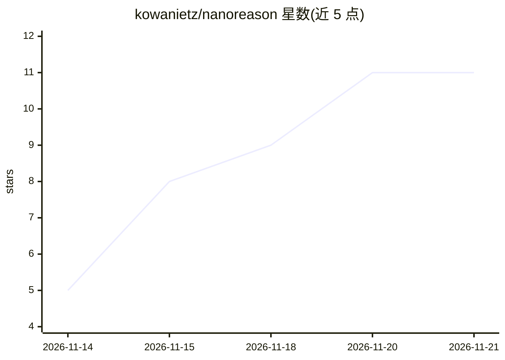

# kowanietz/nanoreason

⭐ 11 · Python · Apache-2.0 · 推送 2026-11-20 · [GitHub](https://github.com/kowanietz/nanoreason) · [官网](https://huggingface.co/collections/kowanietz/nanoreason) · 个人维护

**OLMo 3 7B 推理后训练复现流水线：SFT+GRPO**

对 OLMo 3 7B 执行推理能力后训练的项目：监督微调、重复数据微调与可验证奖励强化学习（Dr. GRPO），产出 SFT/Refined/Think 三个检查点并给出 GPQA、MATH-500、AIME、BBH、IFEval 基准结果。训练在 4×A100 40GB 单节点完成，约 210 GPU 小时，支持 Slurm 提交，评测使用锁定版本的 OLMES 与 vLLM。提供逐阶段脚本、环境分离（SFT/RL/评测）与可复现性说明，但完整重跑未经验证，GPQA 数据需授权且不入库。

## 筛选速览

| 维度 | 判定 | 备注 |
|---|---|---|
| AI 角色 | `ai-native` | 本体是模型或模型工具 |
| 许可风险 | `permissive` | Apache-2.0 |
| 部署形态 | `None` |  |
| 模型依赖 | local-ok | 支持本地模型 |
| 硬件要求 | `gpu-24g` | |
| 安装摩擦 | `medium` | 含编译或系统依赖之一 |
| 成熟度 | — | 结构信号不足 |

## 能力要点

- SFT、重复微调、Dr. GRPO 三阶段后训练流程，含 Slurm 脚本
- 4×A100 40GB 单节点约 210 GPU 小时的记录训练成本
- 评测使用锁定的 OLMES 版本加本地补丁，BF16、32K 上下文
- 基准数据污染控制：基准题哈希排除与重复样本过滤机制

## 适用场景

- 复现或参考 OLMo 3 7B 的推理后训练流程
- 在开源模型上运行 SFT/RLVR 训练实验
- 用 OLMES 对比各训练阶段的基准表现

## 场景标签

`模型评测` `微调` `推理引擎` `强化学习` · 领域:评测与运维

## 证据(README 行号)

> L3: Reasoning post-training of OLMo 3 7B: supervised fine-tuning, repetition SFT, and reinforcement learning with verifi
> L5: Trained on **4× NVIDIA A100 40 GB** (single node). The main training runs account for **~210 GPU-hours**
> L27: |**Think**|NanoReason-7B-Think|Dr. GRPO on math and instruction-following rewards, stopped at step 512|

## 星数曲线

2026-11-14 5 → 2026-11-21 11（+6）

---
*卡片 v1 · prompt 1.4 · 生成 2026-11-20 · 置信度 high · 依据 README sha `c2c29a4d90f6` · [字段定义](../../DATASET.md)*
