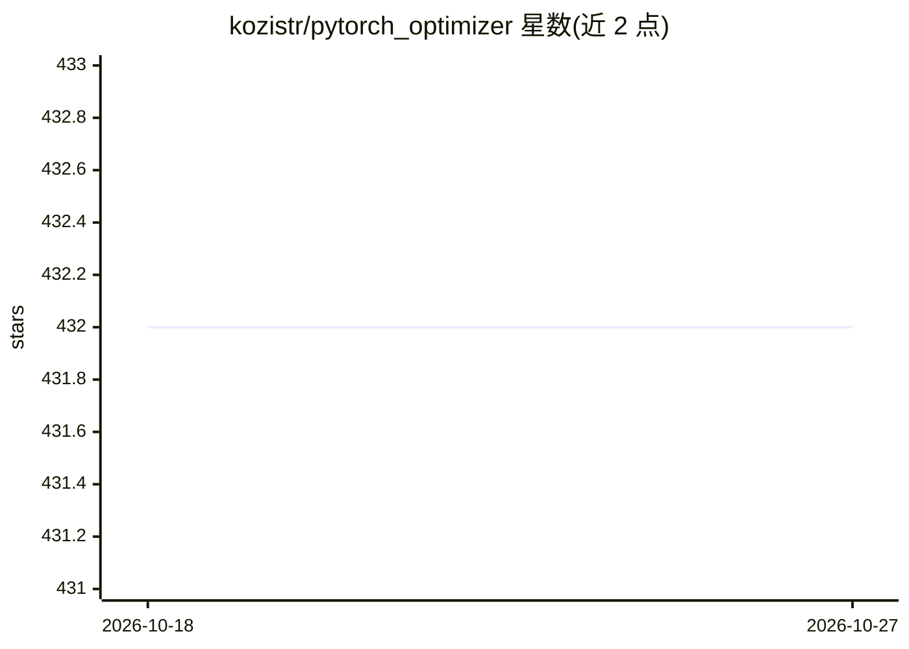

# kozistr/pytorch_optimizer

⭐ 432 · Python · Apache-2.0 · 推送 2026-10-25 · [GitHub](https://github.com/kozistr/pytorch_optimizer) · [官网](https://pytorch-optimizers.readthedocs.io/en/latest/) · 个人维护

**PyTorch 优化器/调度器/损失函数合集库，供训练快速实验**

面向 PyTorch 的优化工具集：以一致 API 提供 100 余种优化器、10 余种学习率调度器与 10 余种损失函数，支持按名称加载、create_optimizer 构建与 torch.hub 加载；提供 foreach 批量更新路径、compile=True 编译融合优化器步、Muon 系列的 FSDP2 多卡多节点训练支持，以及 bitsandbytes、q-galore-torch、torchao 可选生态集成。要求 Python≥3.10、PyTorch≥2.1，pip 安装。面向不想重复编写优化器样板代码的深度学习开发者。

## 筛选速览

| 维度 | 判定 | 备注 |
|---|---|---|
| AI 角色 | `ai-ecosystem` | LLM/agent 周边工具 |
| 许可风险 | `permissive` | Apache-2.0 |
| 部署形态 | `library` | 以包/库形式分发 |
| 模型依赖 | — | README 未给出锁定关系 |
| 硬件要求 | — | 无带数字的原话,不猜 |
| 安装摩擦 | `medium` | 含编译或系统依赖之一 |
| 成熟度 | — | 结构信号不足 |

## 能力要点

- 100+ 优化器、10+ 调度器、10+ 损失函数，统一加载 API
- 支持 torch.compile 编译与 foreach 批量更新路径自动选择
- Muon/MuonClip/AdaMuon 支持 FSDP2 跨 GPU 与节点训练
- 含 GaLore、LOMO、AdEMAMix、Schedule-Free 等近期研究变体

## 适用场景

- 训练实验中快速切换和对比不同优化器与调度器
- 大模型低资源微调（LOMO/AdaLOMO/GaLore 类优化器）
- 多卡/多节点 FSDP2 训练中选用 Muon 系优化器

## 场景标签

 · 领域:深度学习训练工具库

## 证据(README 行号)

> L12: `pytorch-optimizer` is a production-focused optimization toolkit for PyTorch with **100+ optimizers**, **10+ learni
> L22: - Practical features such as `foreach`, `Lookahead`, and `Gradient Centralization` integrations.

## 星数曲线

2026-10-18 432 → 2026-10-27 432（+0）

---
*卡片 v1 · prompt 1.4 · 生成 2026-10-21 · 置信度 high · 依据 README sha `bcee52db56f4` · [字段定义](../../DATASET.md)*
