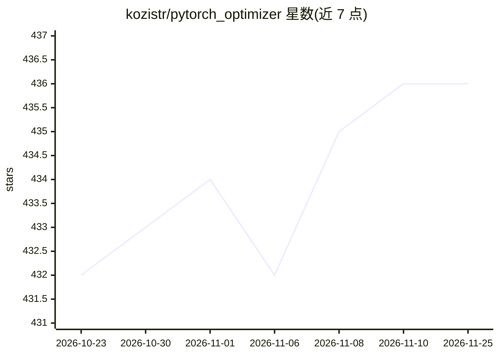

# kozistr/pytorch_optimizer

⭐ 436 · Python · Apache-2.0 · 推送 2026-11-18 · [GitHub](https://github.com/kozistr/pytorch_optimizer) · [官网](https://pytorch-optimizers.readthedocs.io/en/latest/) · 个人维护

**为 PyTorch 开发者提供 100+ 优化器与调度器的统一库**

面向 PyTorch 训练场景的优化工具库，收录 100+ 个优化器、10+ 个学习率调度器与 10+ 个损失函数，通过统一的加载 API（按类直接实例化、按名称加载、create_optimizer 工厂）使用。条目附带论文引用与官方实现链接，支持 torch.hub 加载与 compile=True 的优化器步骤编译融合，Muon 系列支持 FSDP2 跨 GPU/节点训练。依赖 Python >=3.10 与 PyTorch >=2.1，经 pip 安装，可选集成 bitsandbytes、q-galore-torch、torchao。

## 筛选速览

| 维度 | 判定 | 备注 |
|---|---|---|
| AI 角色 | `ai-native` | 本体是模型或模型工具 |
| 许可风险 | `permissive` | Apache-2.0 |
| 部署形态 | `library` | 以包/库形式分发 |
| 模型依赖 | — | README 未给出锁定关系 |
| 硬件要求 | — | 无带数字的原话,不猜 |
| 安装摩擦 | `low` | 无编译、无系统依赖或容器化 |
| 成熟度 | — | 结构信号不足 |

## 能力要点

- 100+ 优化器、10+ 学习率调度器、10+ 损失函数的统一 API
- 三种加载方式：直接类实例化、load_optimizer 按名加载、create_optimizer 工厂
- 支持 compile=True 让 PyTorch 自动融合优化器更新步骤
- 可选集成 bitsandbytes、q-galore-torch、torchao；Muon 系支持 FSDP2

## 适用场景

- 训练模型时试用最新研究优化器而无需自己实现
- 按通配符筛选 adam*、*focal* 等组件做实验对比
- 大模型低显存微调（GaLore、LOMO、LORA 相关优化器）

## 场景标签

`微调` `模型训练` · 领域:训练与推理

## 证据(README 行号)

> L12: `pytorch-optimizer` is a production-focused optimization toolkit for PyTorch with **100+ optimizers**, **10+ learni
> L14: Use it when you want fast experimentation with modern training methods without rewriting optimizer boilerplate.

## 星数曲线

2026-10-23 432 → 2026-11-25 436（+4）

---
*卡片 v1 · prompt 1.4 · 生成 2026-11-25 · 置信度 high · 依据 README sha `6691f4094246` · [字段定义](../../DATASET.md)*
