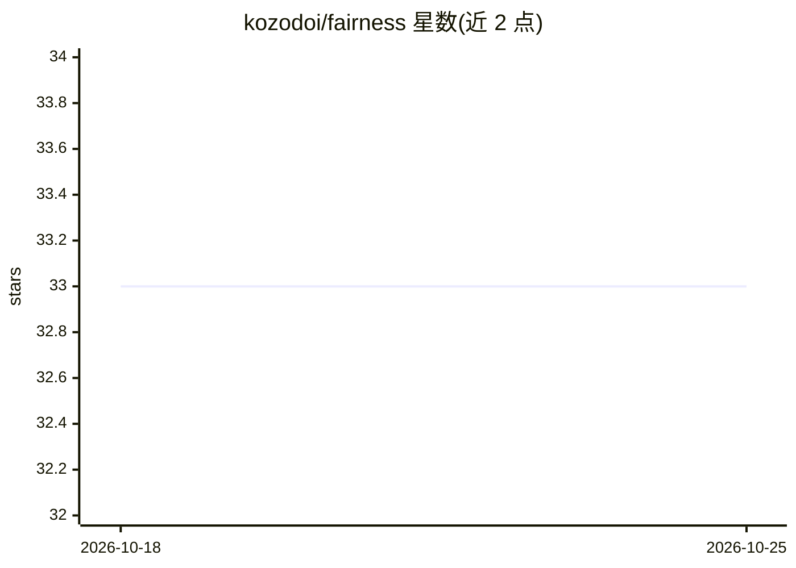

# kozodoi/fairness

⭐ 33 · R · NOASSERTION · 推送 2025-12-13 · [GitHub](https://github.com/kozodoi/fairness) · [官网](https://cran.r-project.org/package=fairness) · 个人维护

**R 包：计算并可视化二分类预测的算法公平性指标**

 fairness 是一个 R 包，基于二分类任务的模型预测，在不同敏感群体间计算 11 种公平性指标（人口平价、机会均等、预测率平价、ROC AUC 平价、MCC 平价等），并支持以条形图等形式可视化与比较各群体的预测指标。函数输入结构统一：结果变量、模型预测与敏感群体特征。附带 COMPAS 示例数据集与 vignette 教程，可从 CRAN 或 GitHub 安装。

## 筛选速览

| 维度 | 判定 | 备注 |
|---|---|---|
| AI 角色 | `ai-ecosystem` | LLM/agent 周边工具 |
| 许可风险 | `none` | NOASSERTION |
| 部署形态 | `None` |  |
| 模型依赖 | — | README 未给出锁定关系 |
| 硬件要求 | — | 无带数字的原话,不猜 |
| 安装摩擦 | `low` | 无编译、无系统依赖或容器化 |
| 成熟度 | — | 结构信号不足 |

## 能力要点

- 实现 11 种公平性指标（demographic parity、equalized odds 等）
- 各群体指标对比与条形图/预测概率可视化
- 内置 COMPAS 示例数据集与 vignette 教程
- 统一的函数输入结构（结果变量、预测、敏感特征）

## 适用场景

- 审计二分类模型在不同敏感群体上的预测公平性
- 为信贷、招聘等高风险决策模型输出公平性报告并可视化
- 教学与研究中复现公平性指标计算

## 场景标签

 · 领域:机器学习公平性评估

## 证据(README 行号)

> L15: The `fairness` R package offers tools to calculate fair ML metrics across different sensitive groups. The metrics a
> L17: The package implements the following fairness metrics:

## 星数曲线

2026-10-18 33 → 2026-10-25 33（+0）

---
*卡片 v1 · prompt 1.4 · 生成 2026-10-25 · 置信度 high · 依据 README sha `4b62595bee4e` · [字段定义](../../DATASET.md)*
