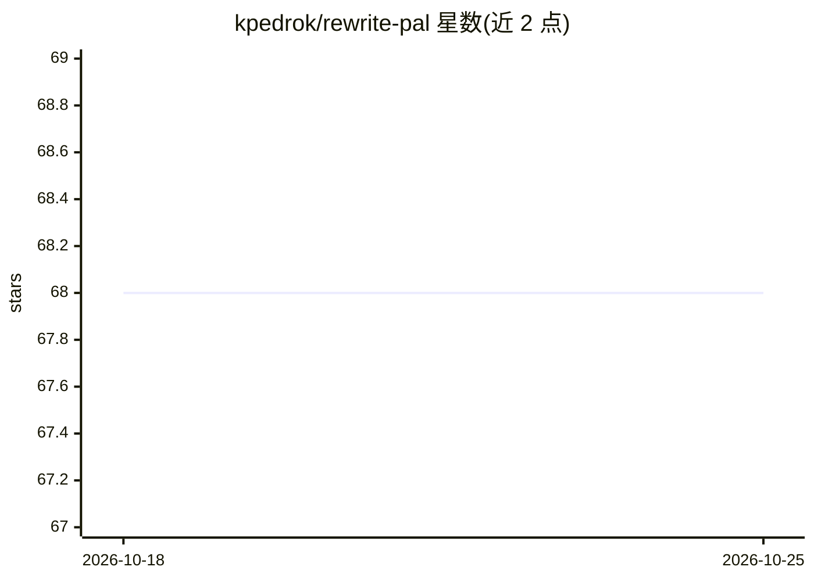

# kpedrok/rewrite-pal

⭐ 68 · TypeScript · MIT · 推送 2026-07-26 · [GitHub](https://github.com/kpedrok/rewrite-pal) · [官网](https://www.rewritepal.com) · 个人维护

**AI 文本改写助手：保留原意，支持语气/角色/语言选项**

基于 Next.js App Router 的生产导向 Web 应用：接收用户提交的文本，调用 OpenAI 生成改写结果，可选语气、角色与语言；使用 Vercel AI SDK、Upstash Redis 做限流与公开改写计数，Zod 契约校验每个改写请求，提示词构造为纯函数并配单测。提交文本发送至 OpenAI，不写入应用数据库或日志。本地开发需 Bun 1.3.14+ 与 Node.js 22+，配置 OpenAI key 与 Upstash Redis 环境变量后运行。

## 筛选速览

| 维度 | 判定 | 备注 |
|---|---|---|
| AI 角色 | `ai-native` | 本体是模型或模型工具 |
| 许可风险 | `permissive` | MIT |
| 部署形态 | `None` |  |
| 模型依赖 | — | README 未给出锁定关系 |
| 硬件要求 | — | 无带数字的原话,不猜 |
| 安装摩擦 | `low` | 无编译、无系统依赖或容器化 |
| 成熟度 | — | 结构信号不足 |

## 能力要点

- OpenAI 驱动的文本改写，保留原意并应用语气/角色/语言选项
- Upstash Redis 限流与公开改写计数
- Zod 请求校验 + 提示词纯函数构造 + 提交的改写评测集
- Playwright 模拟 provider 端点，CI 不消耗 API 额度

## 适用场景

- 改写文本以调整语气、角色或语言
- 部署一个带限流与计数的改写 Web 服务
- 学习 Next.js App Router + AI SDK 的生产化工程结构

## 场景标签

`AI 写作` · 领域:内容生成

## 证据(README 行号)

> L6: RewritePal is a focused AI writing assistant that rewrites supplied text while
> L90: sent to OpenAI to generate a rewrite and is not intentionally written to the

## 星数曲线

2026-10-18 68 → 2026-10-25 68（+0）

---
*卡片 v1 · prompt 1.4 · 生成 2026-10-24 · 置信度 high · 依据 README sha `92afb3965a6e` · [字段定义](../../DATASET.md)*
