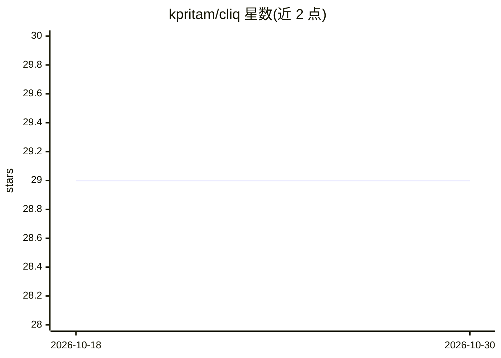

# kpritam/cliq

⭐ 29 · MDX · Apache-2.0 · 推送 2025-11-11 · [GitHub](https://github.com/kpritam/cliq) · [官网](https://kpritam.github.io/cliq/) · 个人维护

**基于 Effect-TS 的多供应商 AI 编程助手 CLI**

用 TypeScript 与 Effect-TS 函数式架构实现的终端 AI 编程助手，运行 bun start 进入交互式聊天，支持 Anthropic/OpenAI/Google 三家供应商（经环境变量配置），内置文件读写编辑（带 diff 预览）、glob 与 ripgrep 搜索工具、会话持久化存储，集成 Vercel AI SDK 并以 Effect 层封装工具适配器。目标运行时为 Bun 1.1+，从源码安装依赖后运行；文档站提供构建系列与 Effect 深度讲解。项目自述受 OpenCode 启发，探索同类概念。

## 筛选速览

| 维度 | 判定 | 备注 |
|---|---|---|
| AI 角色 | `ai-native` | 本体是模型或模型工具 |
| 许可风险 | `permissive` | Apache-2.0 |
| 部署形态 | `None` |  |
| 模型依赖 | — | README 未给出锁定关系 |
| 硬件要求 | — | 无带数字的原话,不猜 |
| 安装摩擦 | `low` | 无编译、无系统依赖或容器化 |
| 成熟度 | — | 结构信号不足 |

## 能力要点

- 交互式聊天模式，支持 /model、/help、/exit 斜杠命令
- 多供应商支持：Anthropic、OpenAI、Google（环境变量配置）
- 文件工具（diff 预览）与 glob/ripgrep 搜索工具
- Vercel AI SDK 集成，Effect 层自定义工具适配器

## 适用场景

- 在终端里通过对话让 AI 读写和编辑项目文件
- 会话中途用 /model 切换不同供应商的模型
- 学习 Effect-TS 在 CLI 工具中的函数式架构实践

## 场景标签

`编码 Agent` · 领域:编码与开发

## 证据(README 行号)

> L3: A functional, Effect-TS-based AI coding assistant CLI with multi-provider support.
> L11: - **Multi-Provider Support**: Anthropic, OpenAI, Google (configured via environment variables)

## 星数曲线

2026-10-18 29 → 2026-10-30 29（+0）

---
*卡片 v1 · prompt 1.4 · 生成 2026-10-26 · 置信度 high · 依据 README sha `cbc9ff68b7bc` · [字段定义](../../DATASET.md)*
