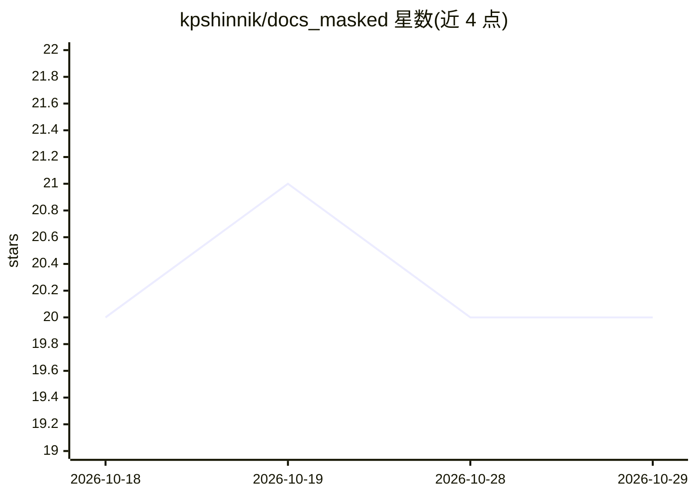

# kpshinnik/docs_masked

⭐ 20 · Python · MIT · 推送 2026-08-18 · [GitHub](https://github.com/kpshinnik/docs_masked) · [官网](https://github.com/kpshinnik/docs_masked#readme) · 个人维护 · 中文 README

**本地文档脱敏工具：发给 LLM 前替换个人信息，回答后还原**

在文档与 LLM 之间的本地隐私层：将文档中的个人数据替换为稳定标签（同一人在全文档获得同一标签），仅标签文本外发，模型回答后通过本地 vault 文件还原原文。内置泄漏控制：外发前重跑检测并按校验和（СНИЛС/ИНН/Luhn/mod-97）验证标识符，命中即阻断并以异常抛出，每次外发写入审计日志。支持 docx/xlsx/pdf 等多种格式，以 Claude Code 技能、MCP 服务器和 CLI 三种形式提供，面向需向模型提交敏感文档的用户；扫描版 PDF 需 OCR，无斯拉夫词尾的拉丁人名不识别。

## 筛选速览

| 维度 | 判定 | 备注 |
|---|---|---|
| AI 角色 | `ai-ecosystem` | LLM/agent 周边工具 |
| 许可风险 | `permissive` | MIT |
| 部署形态 | `None` |  |
| 模型依赖 | — | README 未给出锁定关系 |
| 硬件要求 | — | 无带数字的原话,不猜 |
| 安装摩擦 | `low` | 无编译、无系统依赖或容器化 |
| 成熟度 | — | 结构信号不足 |

## 能力要点

- 同一人的变体（含俄语变格、缩写）映射为同一稳定标签
- 外发前泄漏控制：校验和验证标识符，未清零则阻断发送并写 egress 审计日志
- vault 文件支持 scrypt+Fernet 加密（0600 权限），可精确还原原词形
- MCP 服务器零依赖（仅需 python3），提供 6 个工具

## 适用场景

- 把含个人数据的合同/文档发给 LLM 分析前先脱敏
- 用 Claude Code 或 Cursor 等代理安全处理本地敏感文档
- 对脱敏结果做人工核验（HTML report 逐项展示替换）

## 场景标签

`文档解析` · 领域:知识与检索

## 证据(README 行号)

> L12: документ ──▶ маска ──▶ контроль утечки ──▶ модель ──▶ обратная подстановка
> L16: Работает как скилл для Claude Code, как MCP-сервер для любого другого агента
> L32: **3. Отправка.** Наружу уходит только текст с тегами. Единственная точка

## 星数曲线

2026-10-18 20 → 2026-10-29 20（+0）

---
*卡片 v1 · prompt 1.4 · 生成 2026-10-28 · 置信度 high · 依据 README sha `1afb1bc67305` · [字段定义](../../DATASET.md)*
