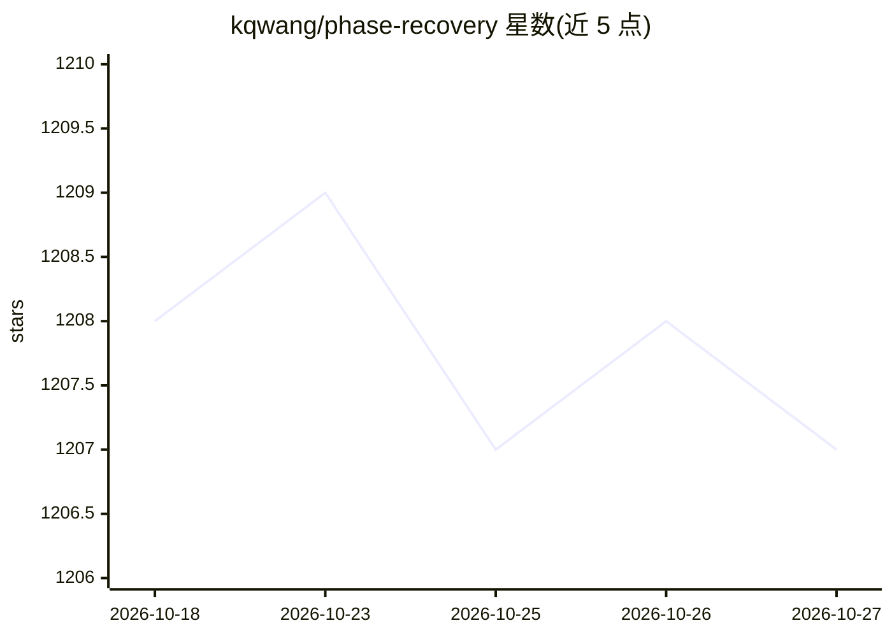

# kqwang/phase-recovery

⭐ 1,207 · MIT · 推送 2026-06-11 · [GitHub](https://github.com/kqwang/phase-recovery) · [官网](https://doi.org/10.1038/s41377-023-01340-x) · 个人维护

**相位恢复领域研究团队与资源策展清单**

计算成像领域的相位恢复（phase recovery/retrieval）资源汇总清单：覆盖全息、干涉测量、光强传输方程、波前传感、叠层成像与深度学习等方法方向。当前可见内容包括按地区（亚洲/美洲/欧洲）组织的全球研究团队与学者名录，每条列出所属机构与研究关键词，并提供关键词检索方式（Ctrl+F）与投稿（Contributing）通道，供查找该领域研究者与课题组使用。

## 筛选速览

| 维度 | 判定 | 备注 |
|---|---|---|
| AI 角色 | `ai-knowledge` | 知识聚合/清单类 |
| 许可风险 | `permissive` | MIT |
| 部署形态 | `None` |  |
| 模型依赖 | — | README 未给出锁定关系 |
| 硬件要求 | — | 无带数字的原话,不猜 |
| 安装摩擦 | `low` | 无编译、无系统依赖或容器化 |
| 成熟度 | — | 结构信号不足 |

## 能力要点

- 按亚洲/美洲/欧洲组织的全球研究团队与学者名录
- 条目标注机构与研究关键词（全息、相位检索、叠层成像等）
- 覆盖相位恢复各技术方向的目录结构与贡献通道

## 适用场景

- 查找相位恢复/计算成像方向的研究团队与学者
- 按研究关键词定位特定方向的课题组
- 了解相位成像领域的研究方向分布

## 场景标签

`精选清单` · 领域:学习与行业

## 证据(README 行号)

> L1: # Resources for phase recovery
> L3: Here, we refer to *“calculating the phase of a light field from

## 星数曲线

2026-10-18 1,208 → 2026-10-27 1,207（-1）

---
*卡片 v1 · prompt 1.4 · 生成 2026-10-21 · 置信度 high · 依据 README sha `3bf66d0372ad` · [字段定义](../../DATASET.md)*
