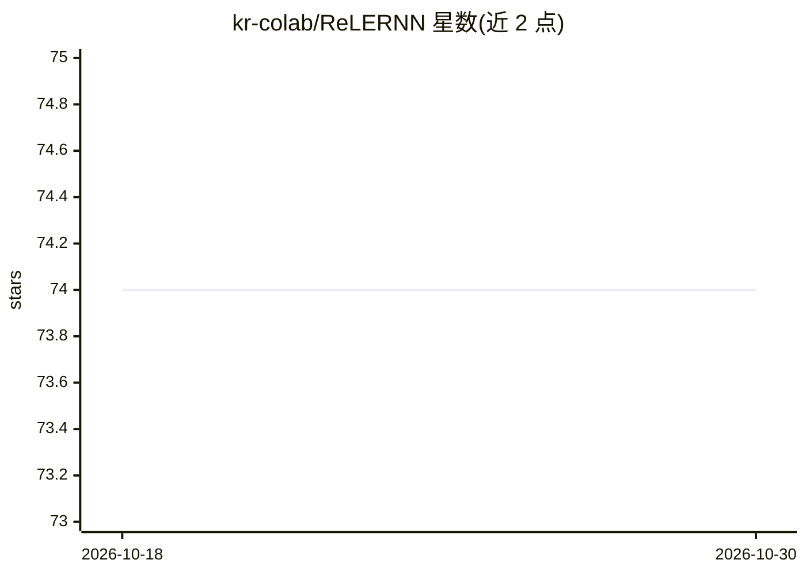

# kr-colab/ReLERNN

⭐ 74 · Python · MIT · 推送 2026-03-27 · [GitHub](https://github.com/kr-colab/ReLERNN) · 组织维护

**用循环神经网络从测序数据推断全基因组重组率图谱的工具**

面向群体基因组学研究者的命令行流程：读取 VCF（个体测序，最少 4 条染色体）或池测序等位基因频率文件，用 msprime 模拟训练集，训练循环神经网络后预测基因组各窗口的每位点重组率；可选模块通过自助模拟生成 95% 置信区间并做系统性偏差校正。流程由 SIMULATE/TRAIN/PREDICT/BSCORRECT 四个命令组成，可用 stairwayplot、SMC++、MSMC 的人口历史输出指导模拟；要求 CUDA NVIDIA GPU（也提供 CPU-only 环境）、Python 3.10+、TensorFlow 2.18+，通过 pixi 安装。

## 筛选速览

| 维度 | 判定 | 备注 |
|---|---|---|
| AI 角色 | `ai-native` | 本体是模型或模型工具 |
| 许可风险 | `permissive` | MIT |
| 部署形态 | `None` |  |
| 模型依赖 | — | README 未给出锁定关系 |
| 硬件要求 | `cpu-ok` | |
| 安装摩擦 | `medium` | 含编译或系统依赖之一 |
| 成熟度 | — | 结构信号不足 |

## 能力要点

- 最少 4 条个体测序染色体或 pool-seq 等位基因频率即可推断重组率图谱
- 四命令流程：模拟训练集、训练 RNN、预测、可选置信区间与偏差校正
- 支持接入 stairwayplot/SMC++/MSMC 的人口历史模拟训练集
- pixi 一步安装 Python/CUDA/依赖，含示例 VCF 与测试脚本

## 适用场景

- 从全基因组测序数据估计物种的重组率landscape
- pool-seq 数据推断重组率
- 为群体遗传分析获取带不确定度的重组率估计

## 场景标签

`科研工具` · 领域:学习与行业

## 证据(README 行号)

> L4: ReLERNN uses deep learning to infer the genome-wide landscape of recombination from as few as four individually sequ
> L86: `ReLERNN_TRAIN` takes the simulations created by `ReLERNN_SIMULATE` and uses them to train a recurrent neural netwo

## 星数曲线

2026-10-18 74 → 2026-10-30 74（+0）

---
*卡片 v1 · prompt 1.4 · 生成 2026-10-24 · 置信度 high · 依据 README sha `4c2fe252cf8d` · [字段定义](../../DATASET.md)*
