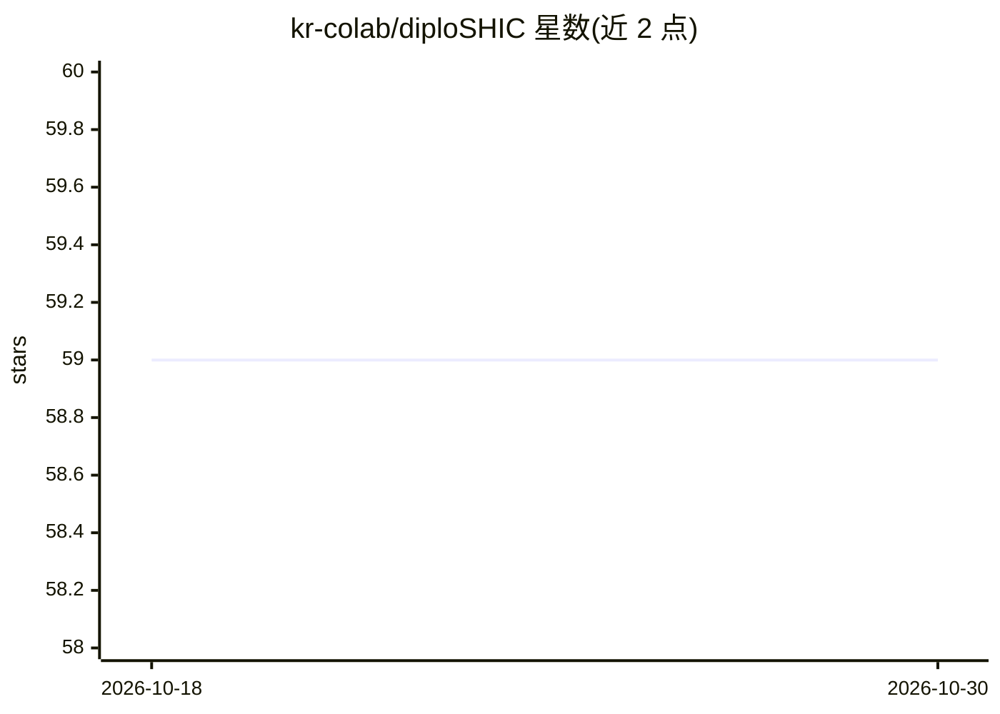

# kr-colab/diploSHIC

⭐ 59 · Python · MIT · 推送 2026-03-31 · [GitHub](https://github.com/kr-colab/diploSHIC) · 组织维护

**深度学习识别群体基因组中选择性扫描的 CNN 工具**

Kern and Schrider (2018) 论文的 diploS/HIC 实现：用深度卷积神经网络从群体基因组数据中识别 hard/soft 选择性扫描。提供四步流程中的后三步——特征向量计算（ms 输出或 VCF）、CNN 训练与经验数据预测；训练用模拟数据需借助 discoal 等外部模拟器生成。以 Python 3.10+ 编写，依赖 TensorFlow/Keras，pip 安装后通过 diploSHIC 命令行的 train/predict/fvecSim/fvecVcf 模式使用，仓库附示例数据与训练/预测演示。

## 筛选速览

| 维度 | 判定 | 备注 |
|---|---|---|
| AI 角色 | `ai-native` | 本体是模型或模型工具 |
| 许可风险 | `permissive` | MIT |
| 部署形态 | `library` | 以包/库形式分发 |
| 模型依赖 | — | README 未给出锁定关系 |
| 硬件要求 | — | 无带数字的原话,不猜 |
| 安装摩擦 | `low` | 无编译、无系统依赖或容器化 |
| 成熟度 | — | 结构信号不足 |

## 能力要点

- CNN 识别 hard/soft 选择性扫描及中性/连锁类别（5 类）
- 从 ms 格式模拟输出或 VCF 文件计算单倍/二倍特征向量
- train/predict CLI 模式，附示例数据可快速跑通训练预测循环
- 训练数据需用 discoal 等外部群体遗传模拟器生成

## 适用场景

- 在群体基因组数据上定位 hard/soft 选择性扫描区域
- 用模拟数据训练选择性扫描分类器并评估准确率
- 对 VCF 格式经验数据计算特征向量并做预测

## 场景标签

 · 领域:生物信息学/群体遗传学

## 证据(README 行号)

> L3: with its associated support scripts. `diploS/HIC` uses a deep convolutional neural network to identify
> L8: 4) prediction on empirical data using the trained network. The software provided here can handle the last three part

## 星数曲线

2026-10-18 59 → 2026-10-30 59（+0）

---
*卡片 v1 · prompt 1.4 · 生成 2026-10-24 · 置信度 high · 依据 README sha `2c34d60d6425` · [字段定义](../../DATASET.md)*
