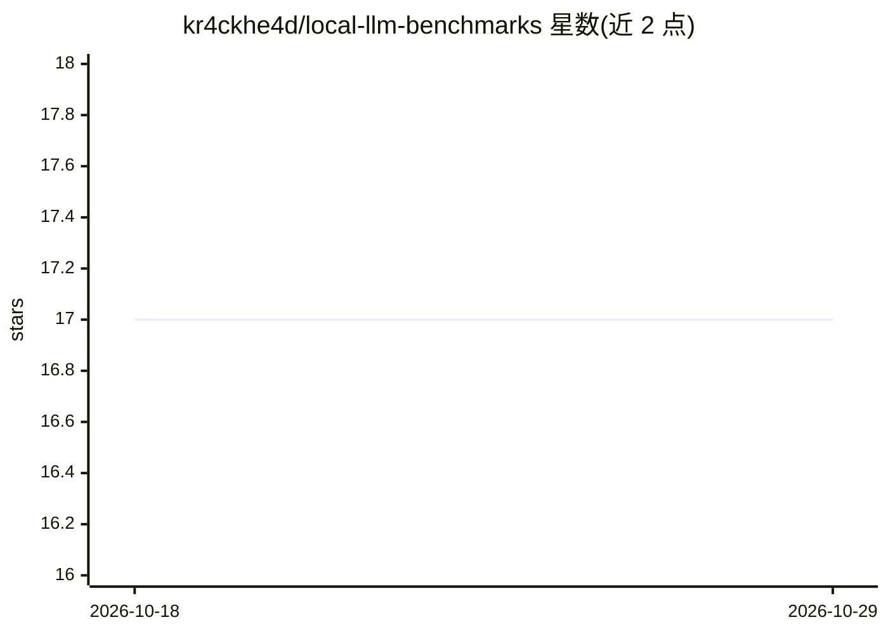

# kr4ckhe4d/local-llm-benchmarks

⭐ 17 · Shell · MIT · 推送 2026-10-22 · [GitHub](https://github.com/kr4ckhe4d/local-llm-benchmarks) · 个人维护

**AMD RDNA4 显卡上 llama.cpp 本地 LLM 实测基准记录**

在消费级 AMD GPU（RX 9070 XT 16GB + Radeon AI PRO R9700，合计 48.9GB VRAM）上以 ROCm 7.2 运行 llama.cpp 的实测数据集：吞吐、VRAM 占用、GGUF 量化质量（对 BF16 的 KL 散度）、MTP 投机解码、128K 长上下文深度表现，以及 Claude Code、aider、Cline 等编码 agent 接本地模型的可用性记录。脚本与原始日志在 benchmarks/ 目录。覆盖 Qwen、Gemma、GLM、gpt-oss 等模型，含 ROCm 与 Vulkan 后端对比及路由预设。

## 筛选速览

| 维度 | 判定 | 备注 |
|---|---|---|
| AI 角色 | `ai-knowledge` | 知识聚合/清单类 |
| 许可风险 | `permissive` | MIT |
| 部署形态 | `None` |  |
| 模型依赖 | — | README 未给出锁定关系 |
| 硬件要求 | — | 无带数字的原话,不猜 |
| 安装摩擦 | `medium` | 含编译或系统依赖之一 |
| 成熟度 | — | 结构信号不足 |

## 能力要点

- 双卡 RDNA4/ROCm 环境下多模型吞吐、VRAM 占用与 128K 深度实测
- GGUF 量化质量以对 BF16 的 KL 散度量化（如 Qwen3.8 UD-Q6_K 为 0.0020）
- ROCm 与 Vulkan 后端逐模型对比及 Vulkan 退役决策记录
- Claude Code / aider / Cline 接本地 llama.cpp 模型的运行记录与预设

## 适用场景

- 评估 AMD RDNA4 显卡跑本地 LLM 的可行性与选型
- 选择 GGUF 量化方案时参考 KLD 与吞吐数据
- 搭建本地编码 agent（Claude Code 等）时参考模型选择与修复经验

## 场景标签

`模型评测` · 领域:评测与运维

## 证据(README 行号)

> L3: Real measurements of local LLMs on consumer AMD GPUs: an **RX 9070 XT (16 GB)**
> L8: local models. Every figure here was measured on this machine; scripts and raw
> L9: logs are in `benchmarks/`.

## 星数曲线

2026-10-18 17 → 2026-10-29 17（+0）

---
*卡片 v1 · prompt 1.4 · 生成 2026-10-29 · 置信度 high · 依据 README sha `2800a53b0931` · [字段定义](../../DATASET.md)*
