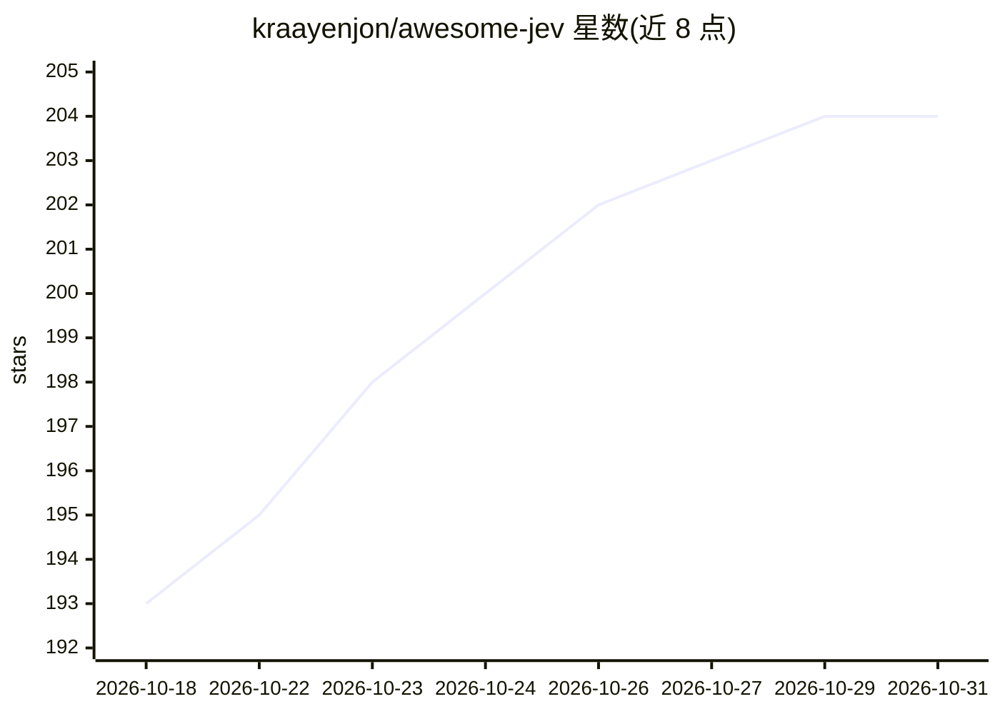

# kraayenjon/awesome-jev

⭐ 204 · NOASSERTION · 推送 2026-09-27 · [GitHub](https://github.com/kraayenjon/awesome-jev) · [官网](https://madewithjev.com) · 组织维护

**Jev（TypeSafe AI System One 模型）用例与资源策展清单**

围绕 TypeSafe AI 的 Jev 模型维护的非官方 awesome 清单：收录用例、SDK、工具与学习资源。Jev 是返回类型化决策（Choice/Score/Noul）与校准概率的 System One 模型，不生成自由文本。清单含 Jev 与 LLM 的对比表、定价与限制快照、Python/TypeScript 快速上手，以及 30 余个附作者报告数字的精选构建（游戏、交易、分类、审核等）。声明与 TypeSafe AI 无隶属，生态处于发布数日内的早期阶段；自述无开放权重。

## 筛选速览

| 维度 | 判定 | 备注 |
|---|---|---|
| AI 角色 | `ai-knowledge` | 知识聚合/清单类 |
| 许可风险 | `none` | NOASSERTION |
| 部署形态 | `library` | 以包/库形式分发 |
| 模型依赖 | — | README 未给出锁定关系 |
| 硬件要求 | — | 无带数字的原话,不猜 |
| 安装摩擦 | `medium` | 含编译或系统依赖之一 |
| 成熟度 | `idea` | |

## 能力要点

- 解释 Jev 三种问题类型（Choice/Score/Noul）与 RLCD 训练机制
- 收录 30 余个带成本/延迟数字的精选构建案例
- 含定价、限制与 API 接入方式快照及 Python/TS SDK 快速上手
- 配套 madewithjev.com 指南目录（729 个构建的数据可引用）

## 适用场景

- 了解 Jev/System One 模型的能力边界与适用任务
- 查找 Jev 的 SDK、网关接入方式与 MCP 工具
- 参考带数字的真实构建案例选型决策层方案

## 场景标签

`精选清单` · 领域:学习与行业

## 证据(README 行号)

> L9:  A curated list of Jev use cases, projects, SDKs, tools, and learning resources.
> L16: ## Contents
> L115: Production-shaped uses with the cost and latency their authors reported. Each links to a full breakdown on madewit

## 星数曲线

2026-10-18 193 → 2026-10-31 204（+11）

---
*卡片 v1 · prompt 1.4 · 生成 2026-10-22 · 置信度 mid · 依据 README sha `94184b6dec55` · [字段定义](../../DATASET.md)*
