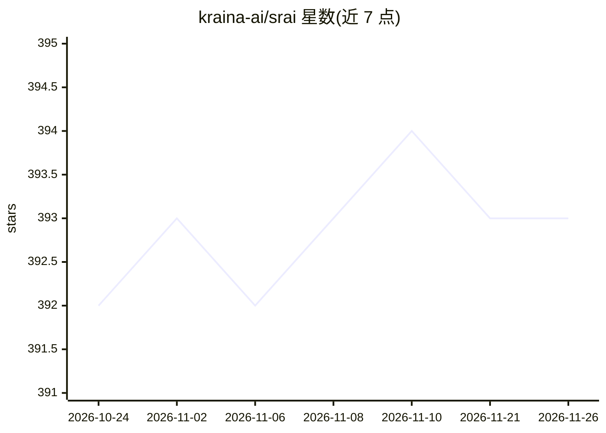

# kraina-ai/srai

⭐ 393 · Python · Apache-2.0 · 推送 2026-11-25 · [GitHub](https://github.com/kraina-ai/srai) · [官网](https://kraina-ai.github.io/srai/) · 组织维护

**给地理空间机器学习研究者提供区域化与空间嵌入的 Python 工具库**

面向矢量几何数据的地理空间机器学习 Python 库，流程为：从 OSM/Overture Maps/GTFS 等来源下载数据，用 H3/S2/Voronoi 等算法将区域切分为微区域，再用 Hex2Vec、GTFS2Vec、CountEmbedder、Highway2Vec 等方法（含 PyTorch 模型，接口类似 scikit-learn 估计器）将区域嵌入向量空间，供下游任务使用。附带数据集与基准模块、可视化工具及部分方法的预训练模型。通过 pip 安装，按功能提供可选依赖组；README 声明库处于重度开发中，小版本间可能出现破坏性变更。

## 筛选速览

| 维度 | 判定 | 备注 |
|---|---|---|
| AI 角色 | `ai-native` | 本体是模型或模型工具 |
| 许可风险 | `permissive` | Apache-2.0 |
| 部署形态 | `library` | 以包/库形式分发 |
| 模型依赖 | — | README 未给出锁定关系 |
| 硬件要求 | — | 无带数字的原话,不猜 |
| 安装摩擦 | `low` | 无编译、无系统依赖或容器化 |
| 成熟度 | `idea` | |

## 能力要点

- OSM/Overture Maps/GTFS 多源空间数据下载与处理
- H3/S2/Voronoi/行政边界等多种区域化算法
- Hex2Vec/GTFS2Vec/Highway2Vec 等嵌入方法，共享统一 API
- 提供下游任务数据集、基准模块与预训练模型

## 适用场景

- 为城市区域生成空间嵌入向量用于下游预测任务
- 下载并处理指定区域的 OpenStreetMap 数据
- 把城市切分为微区域并比较公共交通供给

## 场景标签

`数据分析` `科研工具` · 领域:效率与自动化

## 证据(README 行号)

> L19: Project **Spatial Representations for Artificial Intelligence** (`srai`) is a Python library for geospatial machine
> L29: * **Embedding** - embedding regions into a vector space based on different spatial features, and using different al

## 星数曲线

2026-10-24 392 → 2026-11-26 393（+1）

---
*卡片 v1 · prompt 1.4 · 生成 2026-11-26 · 置信度 high · 依据 README sha `d359ad5ea89d` · [字段定义](../../DATASET.md)*
