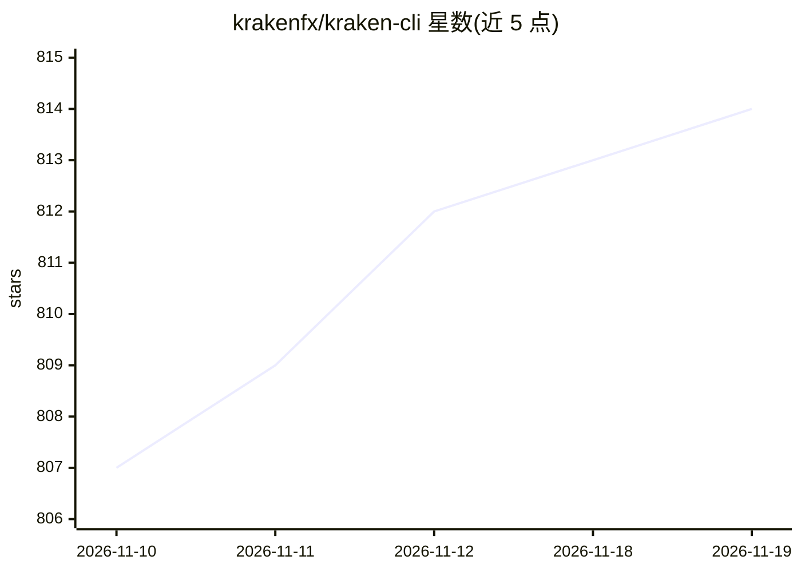

# krakenfx/kraken-cli

⭐ 814 · Rust · MIT · 推送 2026-10-29 · [GitHub](https://github.com/krakenfx/kraken-cli) · [官网](https://kraken.com/kraken-cli) · 组织维护

**Kraken 官方加密货币/股票/外汇/期货交易 CLI，内置 MCP 服务器**

Kraken 官方发布的终端交易工具：一个安装包含 kraken、kraken-mcp 与 kraken-shell 三个二进制，覆盖 1,400+ 加密货币对、170+ 代币化美股/ETF（xStocks）、12 个外汇货币对与 200+ 期货合约。每条命令支持 JSON 输出；内置 MCP 服务器可向 Claude、Cursor、Codex 等 agent 提供最多 152 个工具；支持基于实时价格的模拟交易（无需账户）、市场数据录制回放与评分、59 个 agent 技能，以及 OAuth 登录。README 声明为实验性软件，真实交易无确认提示。macOS/Linux 提供安装器，Windows 需 WSL。

## 筛选速览

| 维度 | 判定 | 备注 |
|---|---|---|
| AI 角色 | `ai-enhanced` | 去掉 AI 部分产品仍成立 |
| 许可风险 | `permissive` | MIT |
| 部署形态 | `desktop` | 安装包/桌面程序 |
| 模型依赖 | — | README 未给出锁定关系 |
| 硬件要求 | — | 无带数字的原话,不猜 |
| 安装摩擦 | `low` | 无编译、无系统依赖或容器化 |
| 成熟度 | `idea` | |

## 能力要点

- 内置 MCP 服务器（kraken-mcp），最多 152 个工具，支持 Claude/Cursor/Codex/Gemini 等 MCP 客户端
- 纸面交易按实时价格成交，无需 Kraken 账户
- 全部命令支持 -o json 输出，错误含稳定 error 字段
- 市场数据录制回放与策略评分，附 59 个 agent 技能

## 适用场景

- 在终端查看行情、下单与管理 Kraken 账户
- 让 Claude Code/Cursor/Codex 等 AI agent 通过 MCP 代为交易或生成晨报
- 用实时价格的纸面交易演练策略

## 场景标签

`金融量化` · 领域:学习与行业

## 证据(README 行号)

> L9: Trade on Kraken from your terminal, or let your AI agent trade for you. One
> L35: - Connect Claude, Cursor, Codex, Gemini and other MCP clients through
> L88: > Experimental software. It interacts with the live Kraken exchange and can

## 星数曲线

2026-11-10 807 → 2026-11-19 814（+7）

---
*卡片 v1 · prompt 1.4 · 生成 2026-11-17 · 置信度 high · 依据 README sha `af9183088548` · [字段定义](../../DATASET.md)*
