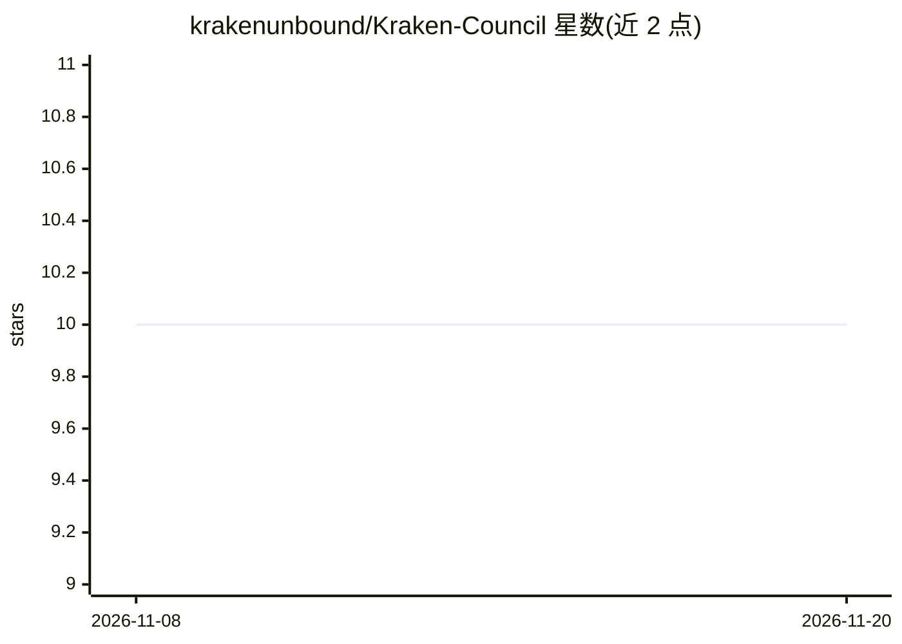

# krakenunbound/Kraken-Council

⭐ 10 · Python · MIT · 推送 2026-07-14 · [GitHub](https://github.com/krakenunbound/Kraken-Council) · 个人维护

**本地多模型辩论桌面应用：让多个本地 LLM 多轮辩论投票**

基于 Qt/PySide6 的桌面应用，编排多个本地 AI 模型组成「委员会」进行多轮辩论：每轮含批评与精炼阶段，最终按相关性、准确性等多标准投票决定答案。支持 LM Studio 与 Ollama 后端的本地模型发现与流式输出，可选接入 Google PSE 联网搜索并附引用标注，另提供 NVIDIA GPU 监控面板。项目定位为概念验证，原作者已停止维护，MIT 许可发布供 fork 与改造。

## 筛选速览

| 维度 | 判定 | 备注 |
|---|---|---|
| AI 角色 | `ai-native` | 本体是模型或模型工具 |
| 许可风险 | `permissive` | MIT |
| 部署形态 | `library` | 以包/库形式分发 |
| 模型依赖 | local-ok | 支持本地模型 |
| 硬件要求 | — | 无带数字的原话,不猜 |
| 安装摩擦 | `low` | 无编译、无系统依赖或容器化 |
| 成熟度 | `idea` | |

## 能力要点

- 多轮辩论机制：批评→精炼阶段 + 多标准投票（避免平票时任意选择）
- 支持 LM Studio 与 Ollama 双后端的本地模型发现与流式输出
- 可选 Google PSE 联网搜索，答案附 [1][2] 式来源引用
- NVIDIA GPU 监控面板：温度/利用率/显存每 2 秒刷新

## 适用场景

- 让多个本地模型对同一问题辩论并投票选出最优回答
- 在本地环境实验多 Agent 协作与辩论编排机制
- 基于此概念验证 fork 构建自己的多模型工具

## 场景标签

`多智能体` · 领域:Agent 开发

## 证据(README 行号)

> L3: Orchestrate a **council of local AI models** with multi-round debates, beautiful model icons, optional web search, a
> L118: - Run multi‑round debates across multiple models.
> L122: - Final answers are voted on using a rich set of criteria (relevance, clarity, completeness, accuracy, helpfulness

## 星数曲线

2026-11-08 10 → 2026-11-20 10（+0）

---
*卡片 v1 · prompt 1.4 · 生成 2026-11-19 · 置信度 high · 依据 README sha `e60da84e82ef` · [字段定义](../../DATASET.md)*
