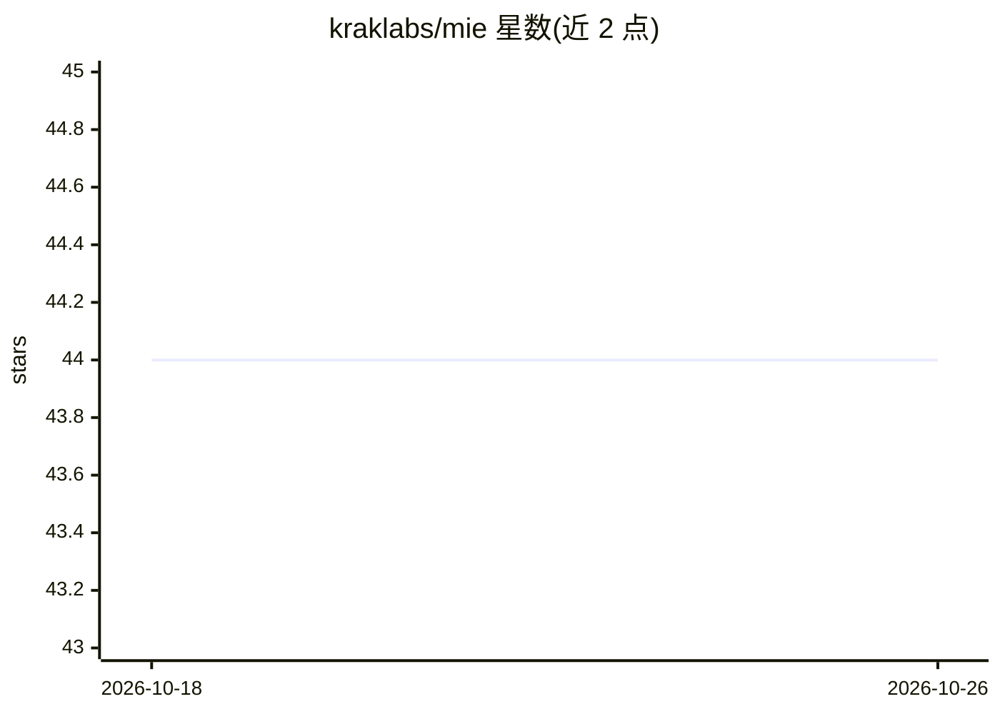

# kraklabs/mie

⭐ 44 · Go · AGPL-3.0 · 推送 2026-03-17 · [GitHub](https://github.com/kraklabs/mie) · [官网](https://kraklabs.com/mie) · 组织维护

**给多 AI agent 共用的持久记忆知识图谱 MCP 服务器**

Go 编写的本地记忆层：以类型化图节点（事实、决策、实体、事件、主题）加有类型关系存储知识，通过 Model Context Protocol 暴露 12 个工具（存储/语义查询/图遍历/失效更新/冲突检测/导出等），供 Claude、Cursor、ChatGPT 等多个 MCP 客户端同时读写，跨会话保留上下文。采用 agent-as-evaluator 模式，服务端零 LLM 推理；嵌入可选，无 Ollama 时仅精确匹配检索。经 Homebrew 安装，守护进程持有数据库锁并复用多客户端访问。

## 筛选速览

| 维度 | 判定 | 备注 |
|---|---|---|
| AI 角色 | `ai-ecosystem` | LLM/agent 周边工具 |
| 许可风险 | `dual` | AGPL-3.0 |
| 部署形态 | `None` |  |
| 模型依赖 | local-ok | 支持本地模型 |
| 硬件要求 | — | 无带数字的原话,不猜 |
| 安装摩擦 | `low` | 无编译、无系统依赖或容器化 |
| 成熟度 | — | 结构信号不足 |

## 能力要点

- 类型化图节点 + 关系的知识存储（事实/决策/实体/事件/主题）
- 12 个 MCP 工具：批量存储、语义检索、图遍历、失效链、冲突检测
- 多 MCP 客户端同时连接，守护进程独占锁并复用访问
- 服务端零 LLM 推理，由连接的 agent 决定存储内容

## 适用场景

- 让 Claude、Cursor、ChatGPT 共享同一份项目决策与背景记忆
- 从代码库、ADR 或 git 历史批量导入知识供 agent 检索
- 跨会话保留架构决策、团队与事件上下文

## 场景标签

`知识图谱` `Agent 记忆` · 领域:Agent 开发

## 证据(README 行号)

> L100: MIE exposes 12 tools through the Model Context Protocol:
> L127: │  Any MCP Client                     │

## 星数曲线

2026-10-18 44 → 2026-10-26 44（+0）

---
*卡片 v1 · prompt 1.4 · 生成 2026-10-25 · 置信度 high · 依据 README sha `32125123bef2` · [字段定义](../../DATASET.md)*
