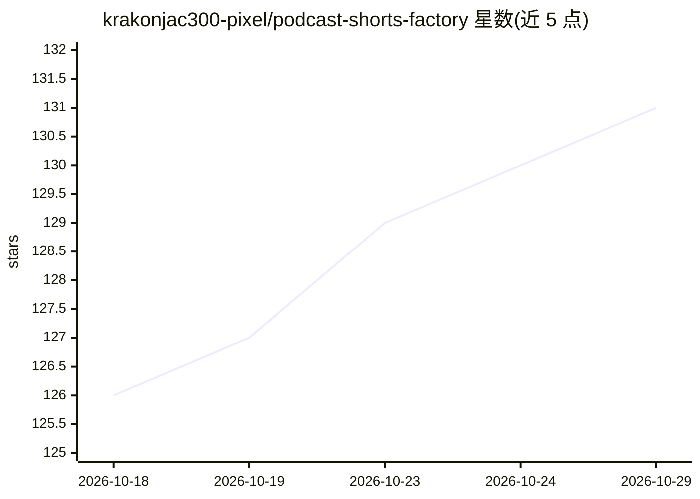

# krakonjac300-pixel/podcast-shorts-factory

⭐ 131 · Python · MIT · 推送 2026-10-09 · [GitHub](https://github.com/krakonjac300-pixel/podcast-shorts-factory) · 个人维护

**十个协作 AI agent 把长播客自动切成竖屏短视频并发布**

面向内容创作者的播客切片自动化工具：输入 YouTube 播客链接，10 个 agent 分工完成转录（本地 faster-whisper）、候选片段 AI 评分、ffmpeg 剪辑成 9:16 竖屏（人脸跟踪、卡拉OK字幕、配乐、b-roll）、标题话题标签撰写、经官方 API 上传或定时发布 YouTube Shorts，并基于播放数据回流改进选片。默认配置指向免费 AI 提供商（OpenRouter/Groq/Gemini/Ollama），转录本地运行，配音用免费 Edge TTS。Python 3.11+ 与 ffmpeg 为前置依赖，提供安装脚本与交互式设置向导，支持每日定时无人值守运行。作者自述输出质量有波动、按现状发布。

## 筛选速览

| 维度 | 判定 | 备注 |
|---|---|---|
| AI 角色 | `ai-native` | 本体是模型或模型工具 |
| 许可风险 | `permissive` | MIT |
| 部署形态 | `None` |  |
| 模型依赖 | local-ok | 支持本地模型 |
| 硬件要求 | — | 无带数字的原话,不猜 |
| 安装摩擦 | `medium` | 含编译或系统依赖之一 |
| 成熟度 | — | 结构信号不足 |

## 能力要点

- 10 个分工 agent 覆盖转录、剪辑、上传、数据回流、趋势、质检等环节
- faster-whisper 本地转录，词级时间戳分块评分长剧集
- 默认接入免费 AI 提供商（OpenRouter/Groq/Gemini/Ollama）
- Finishing Editor 质检渲染结果并拦截问题片段

## 适用场景

- 把长播客自动切成带字幕配乐的竖屏短视频
- 定时无人值守地产出并排期发布 YouTube Shorts
- 基于播放数据反馈持续调整选片策略

## 场景标签

`多智能体` `图像视频处理` `语音识别` · 领域:Agent 开发

## 证据(README 行号)

> L8: You give it a YouTube podcast link. The agents transcribe the episode, find the moments most
> L17: |1|**Finder**|Downloads the podcast and transcribes it with word-level timestamps (faster-whisper), then uses AI to

## 星数曲线

2026-10-18 126 → 2026-10-29 131（+5）

---
*卡片 v1 · prompt 1.4 · 生成 2026-10-23 · 置信度 high · 依据 README sha `7abdf8129be6` · [字段定义](../../DATASET.md)*
