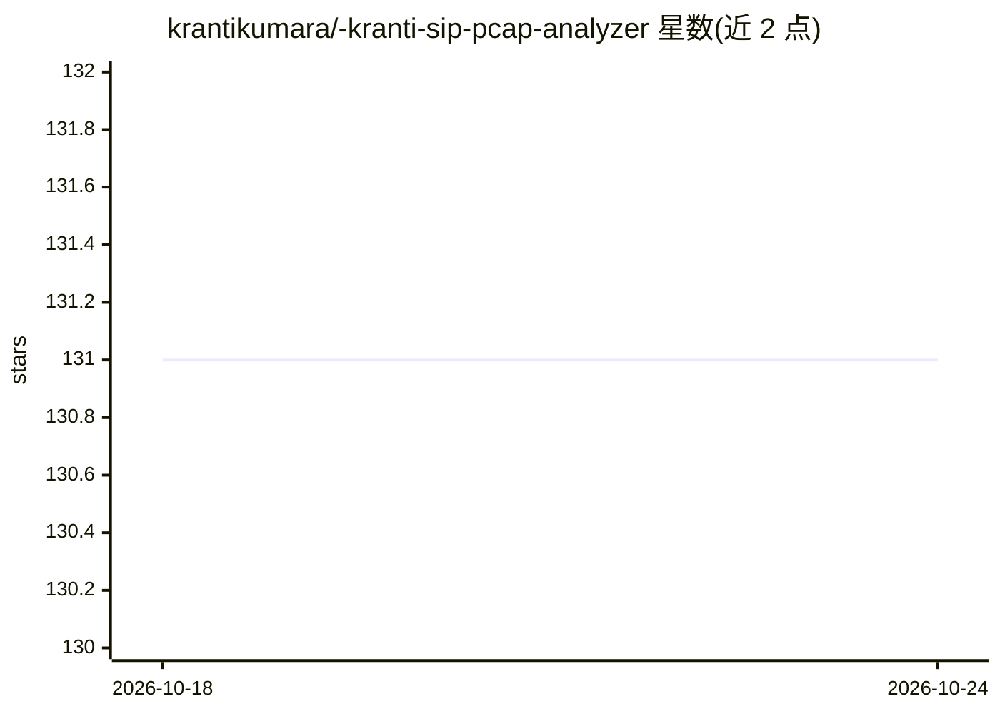

# krantikumara/-kranti-sip-pcap-analyzer

⭐ 131 · Python · 推送 2026-04-18 · [GitHub](https://github.com/krantikumara/-kranti-sip-pcap-analyzer) · 个人维护

**面向 Wireshark 抓包的 SIP 协议分析器，带 GPT-4o 对话**

用 pyshark 解析 PCAP/PCAPNG 文件中的 SIP/SDP 报文：输出完整消息流、SDP 方向属性解读、按 RFC 3264/2543 规则检测呼叫保持与恢复，并生成带标注的 SVG 呼叫流程图。AI 部分通过 Azure OpenAI 的 GPT-4o 提供逐对话根因分析与对抓包内容的问答聊天。以 Gradio Web UI 形式运行（app.py），MIT 许可。

## 筛选速览

| 维度 | 判定 | 备注 |
|---|---|---|
| AI 角色 | `ai-native` | 本体是模型或模型工具 |
| 许可风险 | `none` | — |
| 部署形态 | `library` | 以包/库形式分发 |
| 模型依赖 | locked-api |  |
| 硬件要求 | — | 无带数字的原话,不猜 |
| 安装摩擦 | `low` | 无编译、无系统依赖或容器化 |
| 成熟度 | — | 结构信号不足 |

## 能力要点

- SIP/SDP 报文解析与全字段消息流输出
- RFC 3264 / RFC 2543 呼叫保持与恢复检测
- SVG 呼叫流程图（梯形图）生成
- GPT-4o 逐对话根因分析与对抓包文件的自然语言问答

## 适用场景

- 排查 VoIP 通话中的呼叫保持/恢复异常
- 可视化 SIP 呼叫信令流程
- 用自然语言向 AI 询问抓包中的问题原因

## 场景标签

`文档问答` · 领域:知识与检索

## 证据(README 行号)

> L3: AI-powered SIP protocol analyzer for Wireshark PCAP/PCAPNG files.
> L11: - **AI Dialog Analysis** — GPT-4o root cause analysis per dialog

## 星数曲线

2026-10-18 131 → 2026-10-24 131（+0）

---
*卡片 v1 · prompt 1.4 · 生成 2026-10-23 · 置信度 high · 依据 README sha `e4d9f9e54e57` · [字段定义](../../DATASET.md)*
