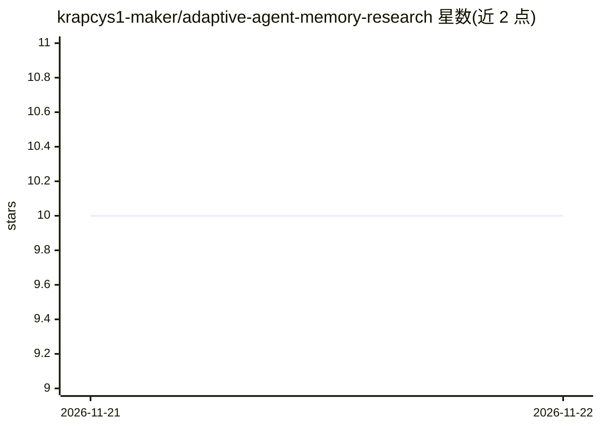

# krapcys1-maker/adaptive-agent-memory-research

⭐ 10 · Python · Apache-2.0 · 推送 2026-11-21 · [GitHub](https://github.com/krapcys1-maker/adaptive-agent-memory-research) · 个人维护

**LLM agent 经验记忆的对照实验研究项目与结果登记库**

以阶梯式实验研究 LLM agent 的经验记忆：回答“在正确时机向执行任务的 agent 展示其此前成功运行的相似片段，是否提升任务解决率”。每个阶梯只加一个变量，并与无记忆及 token 数对齐的安慰剂对照进行比较，所有结果带 95% 区间、caveats 与 erratum，发布结果经代码从知识文件与 SHA-256 摘要交叉核验，可本地脚本复算。提供 git clone 安装路径、CI 检查入口，以及 GPU 单元认领机制（单单元约 12 GB/2 小时）供社区分担算力。面向研究者与希望参与实验的贡献者。

## 筛选速览

| 维度 | 判定 | 备注 |
|---|---|---|
| AI 角色 | `ai-knowledge` | 知识聚合/清单类 |
| 许可风险 | `permissive` | Apache-2.0 |
| 部署形态 | `library` | 以包/库形式分发 |
| 模型依赖 | — | README 未给出锁定关系 |
| 硬件要求 | — | 无带数字的原话,不猜 |
| 安装摩擦 | `low` | 无编译、无系统依赖或容器化 |
| 成熟度 | — | 结构信号不足 |

## 能力要点

- 已发布实验（ALFWORLD-LADDER-R4-V5B，n=201）附 95% 区间与方向状态
- 本地脚本 verify_autolab_packages.py 可从数据包复算全部已发布数字
- 阶梯式设计：每个阶梯单变量，配无记忆与随机文本库对照
- GPU 计算拆分为约 2 小时单元，可由志愿者认领

## 适用场景

- 复算并核查已发布的 agent 记忆实验结果
- 在没有 GPU 的机器上参与分析、测试与文档贡献
- 研究经验检索相对安慰剂对照的真实增益

## 场景标签

`Agent 记忆` `模型评测` `科研工具` · 领域:Agent 开发

## 证据(README 行号)

> L11: An agent that does tasks (in a home simulator, a science lab simulator, later with real tools) should get better fr
> L42: Every number above is copied by code from the results table of the package README it links to. The primary comparis
> L86: Rules that keep it honest: development on a frozen 60-task subset of ALFWorld `valid_seen`; **ALFWorld `valid_unsee

## 星数曲线

2026-11-21 10 → 2026-11-22 10（+0）

---
*卡片 v1 · prompt 1.4 · 生成 2026-11-21 · 置信度 high · 依据 README sha `5fb6284e0b34` · [字段定义](../../DATASET.md)*
