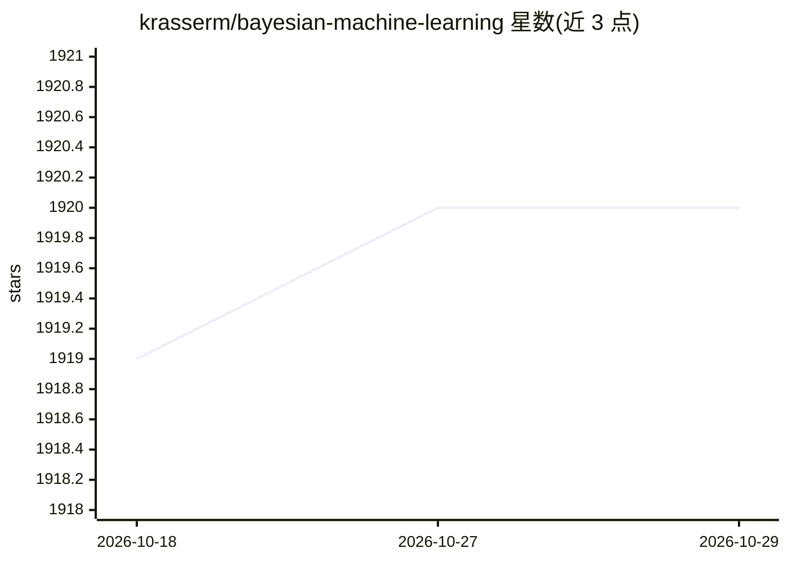

# krasserm/bayesian-machine-learning

⭐ 1,920 · Jupyter Notebook · Apache-2.0 · 推送 2026-07-12 · [GitHub](https://github.com/krasserm/bayesian-machine-learning) · 个人维护

**贝叶斯机器学习方法的教学笔记本合集**

由个人维护的 Jupyter 笔记本集合，讲解贝叶斯机器学习方法：贝叶斯线性回归、高斯过程（回归/分类/稀疏变分）、贝叶斯优化、贝叶斯神经网络变分推断、噪声对比先验不确定性估计、EM 与高斯混合模型、随机变分推断与变分自编码器等。实现涵盖纯 NumPy/SciPy、scikit-learn、JAX、Keras、TensorFlow 2 与 GPy/GPyOpt，依赖在各子目录的 requirements.txt 中指定，部分笔记本可在 Colab 打开。

## 筛选速览

| 维度 | 判定 | 备注 |
|---|---|---|
| AI 角色 | `ai-knowledge` | 知识聚合/清单类 |
| 许可风险 | `permissive` | Apache-2.0 |
| 部署形态 | `None` |  |
| 模型依赖 | — | README 未给出锁定关系 |
| 硬件要求 | — | 无带数字的原话,不猜 |
| 安装摩擦 | `low` | 无编译、无系统依赖或容器化 |
| 成熟度 | — | 结构信号不足 |

## 能力要点

- 覆盖贝叶斯回归、高斯过程、贝叶斯优化、贝叶斯神经网络等主题的笔记本
- 同一主题提供多种实现（纯 NumPy/SciPy、scikit-learn、JAX、Keras、TensorFlow 2）
- 含变分自编码器与潜空间贝叶斯优化条件生成等专题
- 依赖按子目录 requirements.txt 分别指定

## 适用场景

- 学习贝叶斯方法及其代码实现
- 了解高斯过程与贝叶斯优化的应用（如超参数调优）
- 参考贝叶斯神经网络的不确定性估计做法

## 场景标签

`教程课程` · 领域:学习与行业

## 证据(README 行号)

> L5: This repository is a collection of notebooks about *Bayesian Machine Learning*. The following links display
> L6: some of the notebooks via nbviewer to ensure a proper rendering of formulas.

## 星数曲线

2026-10-18 1,919 → 2026-10-29 1,920（+1）

---
*卡片 v1 · prompt 1.4 · 生成 2026-10-21 · 置信度 high · 依据 README sha `b74f3b0351f1` · [字段定义](../../DATASET.md)*
