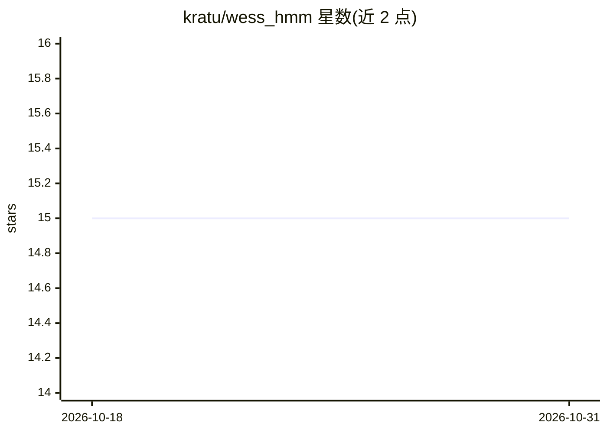

# kratu/wess_hmm

⭐ 15 · Python · Apache-2.0 · 推送 2026-04-07 · [GitHub](https://github.com/kratu/wess_hmm) · 个人维护

**量化研究者用 HMM+Wasserstein 混合模型做市场状态识别**

将高斯 HMM 的时间概率推断与基于 Wasserstein 距离的分布聚类结合，把实时行情划分为 Trending/Range/Choppy/Transitional 四类状态。离线阶段用动量、波动率、ATR、滚动收益等特征无监督训练，产物以 joblib 持久化；在线阶段通过 OpenAlgo API 拉取分钟级行情并输出带置信度与熵诊断的状态标签和可视化。供量化研究与算法实验使用，作者声明其并非生产级交易信号生成器，且对特征漂移敏感需定期重校准。

## 筛选速览

| 维度 | 判定 | 备注 |
|---|---|---|
| AI 角色 | `ai-native` | 本体是模型或模型工具 |
| 许可风险 | `permissive` | Apache-2.0 |
| 部署形态 | `library` | 以包/库形式分发 |
| 模型依赖 | — | README 未给出锁定关系 |
| 硬件要求 | — | 无带数字的原话,不猜 |
| 安装摩擦 | `low` | 无编译、无系统依赖或容器化 |
| 成熟度 | — | 结构信号不足 |

## 能力要点

- HMM 后验概率与 Wasserstein 距离加权融合的门控判定逻辑
- 多尺度平滑与熵-置信度过滤减少状态抖动
- 提供预训练 .p 模型文件与诊断可视化脚本
- 通过 OpenAlgo API 获取实盘/近期数据并输出实时状态标签

## 适用场景

- 研究趋势/震荡/混乱行情的状态识别方法
- 为算法交易实验提供 regime-aware 的市场结构标注
- 教学场景演示 HMM 与分布聚类混合建模

## 场景标签

`金融量化` · 领域:学习与行业

## 证据(README 行号)

> L7: This repository implements a **hybrid market regime inference system** combining **Hidden Markov Models (HMM)** with
> L189: This repository is meant for **quantitative research, algorithmic experimentation, and educational use**.

## 星数曲线

2026-10-18 15 → 2026-10-31 15（+0）

---
*卡片 v1 · prompt 1.4 · 生成 2026-10-30 · 置信度 mid · 依据 README sha `f8cd6cc5dfd4` · [字段定义](../../DATASET.md)*
