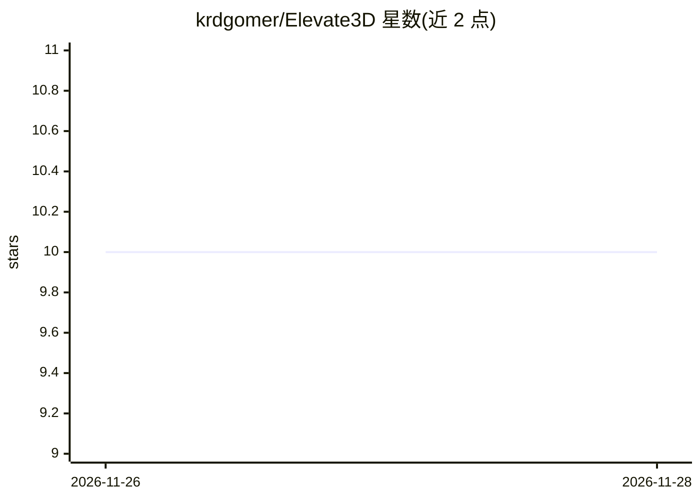

# krdgomer/Elevate3D

⭐ 10 · Python · MIT · 推送 2026-05-03 · [GitHub](https://github.com/krdgomer/Elevate3D) · 个人维护

**从卫星/航拍图像生成建筑三维模型的深度学习流水线**

面向需要从遥感影像获得三维输出的用户：输入 RGB 航拍/卫星图像，依次经 Mask R-CNN 分割建筑、Pix2Pix 从 RGB 生成 DSM 高程、DeepForest 检测树木、Open3D 构建 .glb 网格，端到端无需训练，提供预训练模型。使用方式包括本地 Web 界面（上传图像并在浏览器交互查看）与 Python API。README 声明为实验性早期项目，未达生产可用，结果可能不一致并含伪影。

## 筛选速览

| 维度 | 判定 | 备注 |
|---|---|---|
| AI 角色 | `ai-native` | 本体是模型或模型工具 |
| 许可风险 | `permissive` | MIT |
| 部署形态 | `library` | 以包/库形式分发 |
| 模型依赖 | — | README 未给出锁定关系 |
| 硬件要求 | — | 无带数字的原话,不猜 |
| 安装摩擦 | `low` | 无编译、无系统依赖或容器化 |
| 成熟度 | `idea` | |

## 能力要点

- Mask R-CNN 自动建筑分割 + Pix2Pix 高程预测
- Open3D 生成可交互的 .glb 三维网格
- 提供预训练模型，无需自行训练
- 本地 Web 界面与 Python API 两种运行方式

## 适用场景

- 把卫星或航拍影像转成建筑三维模型
- 在浏览器中交互查看影像对应的三维输出
- 用 Python API 批量跑图像到网格的流水线

## 场景标签

`目标检测` · 领域:感知与多模态

## 证据(README 行号)

> L3: **Generate 3D models from satellite & aerial images using deep learning.**
> L12: - ✅ Automatic Building Segmentation (Mask R-CNN)
> L17: - ✅ End-to-End Pipeline – From image to interactive 3D output

## 星数曲线

2026-11-26 10 → 2026-11-28 10（+0）

---
*卡片 v1 · prompt 1.4 · 生成 2026-11-26 · 置信度 high · 依据 README sha `2aa15fee1d25` · [字段定义](../../DATASET.md)*
