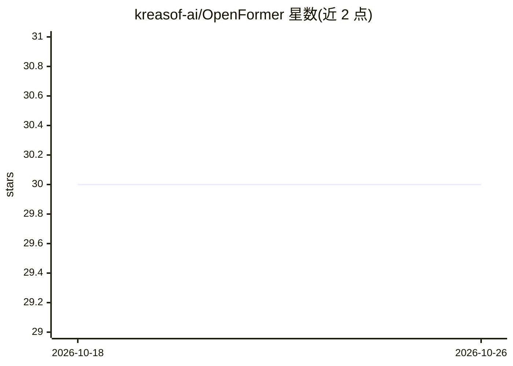

# kreasof-ai/OpenFormer

⭐ 30 · Python · Apache-2.0 · 推送 2026-02-10 · [GitHub](https://github.com/kreasof-ai/OpenFormer) · 组织维护

**基于 tinygrad 的 LLM 运行与微调库，面向非 NVIDIA GPU**

Kreasof AI 开源的库，用于在 AMD、Intel、Apple Silicon 等 GPU 上运行和微调现代 transformer 模型，底层依赖 tinygrad。提供 LFM2、Qwen、Llama 3、Gemma 3、EXAONE 4、Falcon H1 等架构的从零实现，输出与 Hugging Face Transformers 数值一致性验证；内置 LoRA 监督微调脚本与 INT8/NF4 量化、Paged/Flash Attention 实验 Kernel。限制：tinygrad JIT 面向固定形状，自回归推理较慢（LFM2-350M 在 RX 6700 XT 上约 6.5 token/s），训练则因固定 batch 性能较好。

## 筛选速览

| 维度 | 判定 | 备注 |
|---|---|---|
| AI 角色 | `ai-ecosystem` | LLM/agent 周边工具 |
| 许可风险 | `permissive` | Apache-2.0 |
| 部署形态 | `library` | 以包/库形式分发 |
| 模型依赖 | — | README 未给出锁定关系 |
| 硬件要求 | — | 无带数字的原话,不猜 |
| 安装摩擦 | `low` | 无编译、无系统依赖或容器化 |
| 成熟度 | — | 结构信号不足 |

## 能力要点

- 支持 AMD/Intel/Apple Silicon 等非 NVIDIA GPU 上的训练与推理
- 覆盖 LFM2/Qwen/Llama 3/Gemma 3/EXAONE 4/Falcon H1 等模型族
- 内置 LoRA 微调脚本与 INT8/NF4 量化
- 实现与 Hugging Face Transformers 做数值一致性验证

## 适用场景

- 在没有 NVIDIA GPU 的机器上微调或运行开源 LLM
- 作为理解 LLM 内部实现的透明教学参考
- 低显存环境用 NF4/INT8 量化运行模型

## 场景标签

`微调` `模型量化` `推理引擎` · 领域:训练与推理

## 证据(README 行号)

> L6: A hackable library for running and fine-tuning modern transformer models on commodity and alternative GPUs, powered 
> L10: Built on a unified, extensible architecture, OpenFormer liberates you to train, fine-tune, and run state-of-the-art
> L15: * ✅ **Simplify Complexity:** Provide a clean, understandable, and "hackable" from-scratch implementation of modern 

## 星数曲线

2026-10-18 30 → 2026-10-26 30（+0）

---
*卡片 v1 · prompt 1.4 · 生成 2026-10-26 · 置信度 high · 依据 README sha `d5ad6e416608` · [字段定义](../../DATASET.md)*
