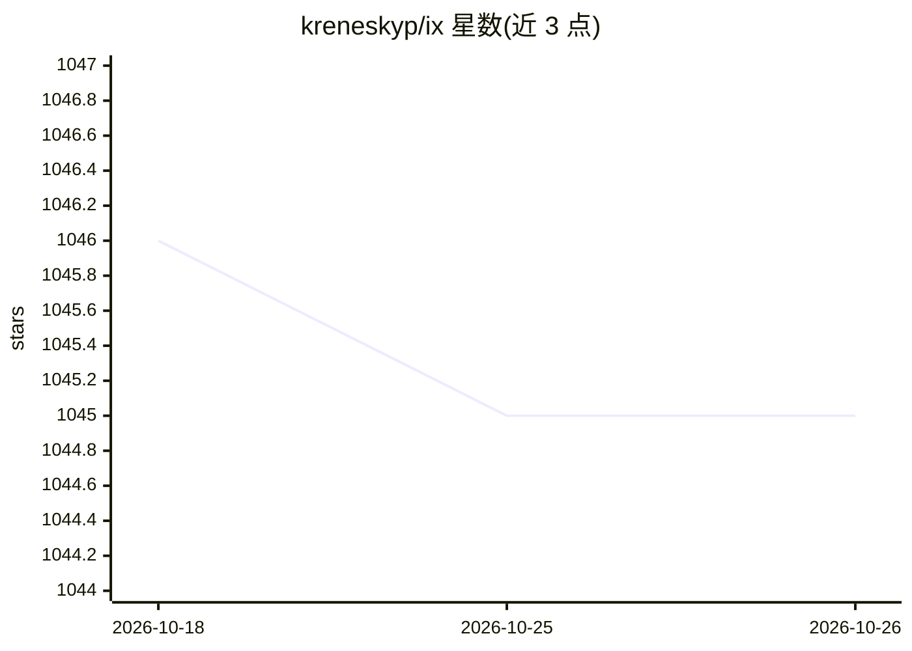

# kreneskyp/ix

⭐ 1,045 · Python · MIT · 推送 2026-10-10 · [GitHub](https://github.com/kreneskyp/ix) · 个人维护

**设计并部署自主 LLM 智能体与工作流的平台**

IX 是用于设计和部署自主/半自主 LLM 智能体与工作流的开源平台，面向开发者。提供无代码节点图编辑器创建与调试智能体、支持多智能体的聊天界面（内置 moderator 智能体按 @mention 分派任务）、基于 Celery 消息队列的 Docker 化 worker 可横向扩展并行运行智能体。模型支持 OpenAI、Google PaLM、Anthropic、Llama（后三者标注实验性），组件配置层将 LangChain 组件映射到配置图。通过 pip 安装 agent-ix CLI 或 docker-compose 运行集群，需配置 OPENAI_API_KEY。

## 筛选速览

| 维度 | 判定 | 备注 |
|---|---|---|
| AI 角色 | `ai-ecosystem` | LLM/agent 周边工具 |
| 许可风险 | `permissive` | MIT |
| 部署形态 | `library` | 以包/库形式分发 |
| 模型依赖 | locked-api |  |
| 硬件要求 | — | 无带数字的原话,不猜 |
| 安装摩擦 | `low` | 无编译、无系统依赖或容器化 |
| 成熟度 | — | 结构信号不足 |

## 能力要点

- 无代码节点图编辑器创建与测试智能体，聊天内嵌调试
- 多智能体聊天界面，IX moderator 自动分派任务
- Celery 消息队列驱动的 Docker 化 worker，可横向扩展
- 组件配置层将 LangChain 组件映射到配置图

## 适用场景

- 搭建并行协作的多智能体团队完成编码、数据分析等任务
- 用无代码编辑器搭建与调试 LLM 工作流
- 通过 ix scale 命令按 CPU/内存容量扩展智能体 worker 数量

## 场景标签

`Agent 框架` `多智能体` `工作流自动化` · 领域:Agent 开发

## 证据(README 行号)

> L17: IX is a platform for designing and deploying autonomous and [semi]-autonomous LLM powered agents and workflows. IX
> L31: ### 🧠 Models

## 星数曲线

2026-10-18 1,046 → 2026-10-26 1,045（-1）

---
*卡片 v1 · prompt 1.4 · 生成 2026-10-21 · 置信度 high · 依据 README sha `873626b7f59f` · [字段定义](../../DATASET.md)*
