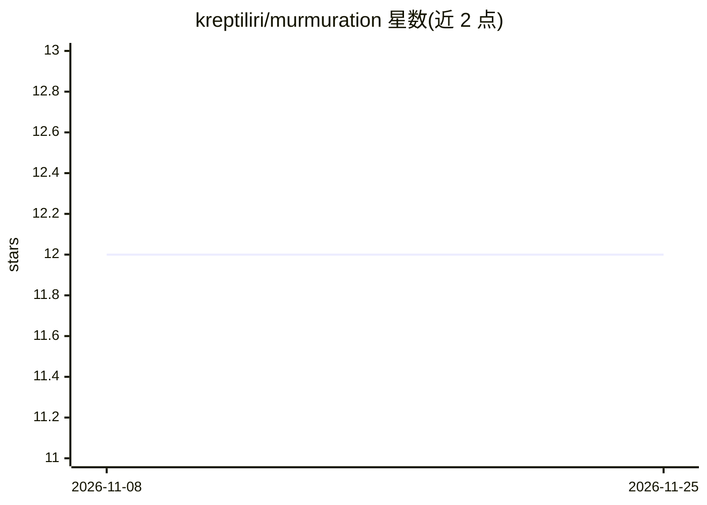

# kreptiliri/murmuration

⭐ 12 · Python · MIT · 推送 2026-10-10 · [GitHub](https://github.com/kreptiliri/murmuration) · [官网](https://kreptiliri.github.io/murmuration/) · 个人维护

**用小型 Transformer 学习 boids 鸟群飞行并做可解释性分析**

研究型项目：实现一个带分离/对齐/聚合三规则的 boids 模拟器，生成轨迹数据集训练小型 Transformer 预测每只鸟的下一时刻速度变化；再用 ridge 回归探针从模型隐藏状态读取各规则的作用量，并用消融实验验证模型对规则的实际依赖。包含模拟、生成、训练、探针、消融、回放与绘图脚本，全部可在笔记本 CPU 上运行，训练一轮约 40 分钟。作者为个人，附带项目过程记录与 MIT 许可。

## 筛选速览

| 维度 | 判定 | 备注 |
|---|---|---|
| AI 角色 | `ai-native` | 本体是模型或模型工具 |
| 许可风险 | `permissive` | MIT |
| 部署形态 | `library` | 以包/库形式分发 |
| 模型依赖 | — | README 未给出锁定关系 |
| 硬件要求 | — | 无带数字的原话,不猜 |
| 安装摩擦 | `low` | 无编译、无系统依赖或容器化 |
| 成熟度 | — | 结构信号不足 |

## 能力要点

- boids 模拟器逐 tick 记录每条规则对每只鸟的推力
- Transformer 在未训练过的 300 个片段上预测 R² 0.990–0.994
- ridge 探针读取隐藏状态中的规则推力，配合消融验证因果使用
- 训练好的模型可自主驱动鸟群飞行（rollout）

## 适用场景

- 研究模型内部是否真正使用了已知规则而非仅拟合轨迹
- 复现机器学习可解释性实验（探针+消融流程）
- 在 CPU 上跑通模拟数据生成到训练到分析的全流程

## 场景标签

 · 领域:机器学习/可解释性研究

## 证据(README 行号)

> L5: A small transformer learns to fly a boids flock by watching, then I check where it keeps the three rules.
> L23: - `flocker.py`: the models. A transformer with one token per tick, one with one token per bird, and `RelPerBirdTran

## 星数曲线

2026-11-08 12 → 2026-11-25 12（+0）

---
*卡片 v1 · prompt 1.4 · 生成 2026-11-18 · 置信度 high · 依据 README sha `5b07ccebd91d` · [字段定义](../../DATASET.md)*
