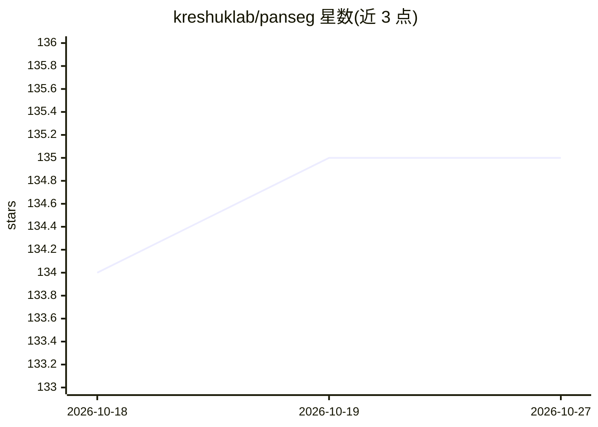

# kreshuklab/panseg

⭐ 135 · Python · MIT · 推送 2026-10-26 · [GitHub](https://github.com/kreshuklab/panseg) · [官网](https://kreshuklab.github.io/panseg/latest/) · 组织维护

**密集 3D 体积图像的细胞实例分割工具（含预训练模型）**

面向显微镜三维体积图像的细胞实例感知分割工具：采用神经网络分割加后处理分割的两阶段流程，针对共聚焦与光片显微镜采集的植物细胞组织调优，同时覆盖动物细胞。提供预训练模型，发行形式包括带 Python 与 conda 的安装器、conda 环境开发安装及 anaconda 包。项目始于 2020 年的 PlantSeg，2.0 版本更名以反映植物与动物细胞的适用范围。采用 Effort Versioning 版本策略。

## 筛选速览

| 维度 | 判定 | 备注 |
|---|---|---|
| AI 角色 | `ai-native` | 本体是模型或模型工具 |
| 许可风险 | `permissive` | MIT |
| 部署形态 | `None` |  |
| 模型依赖 | — | README 未给出锁定关系 |
| 硬件要求 | — | 无带数字的原话,不猜 |
| 安装摩擦 | `low` | 无编译、无系统依赖或容器化 |
| 成熟度 | — | 结构信号不足 |

## 能力要点

- 两阶段策略：神经网络分割 + 实例分割
- 提供预训练模型
- 针对共聚焦与光片显微镜植物组织调优，亦适用动物细胞
- 提供带 Python 与 conda 的独立安装器

## 适用场景

- 对密集排列的 3D 显微图像做细胞实例分割
- 植物与动物组织的细胞级 3D 重建分析
- 复现论文中的定量评估结果

## 场景标签

`目标检测` · 领域:感知与多模态

## 证据(README 行号)

> L16: PanSeg is a tool for cell instance aware segmentation in densely packed 3D volumetric images.
> L17: The pipeline uses a two stages segmentation strategy (Neural Network + Segmentation).

## 星数曲线

2026-10-18 134 → 2026-10-27 135（+1）

---
*卡片 v1 · prompt 1.4 · 生成 2026-10-22 · 置信度 high · 依据 README sha `009390a8e022` · [字段定义](../../DATASET.md)*
