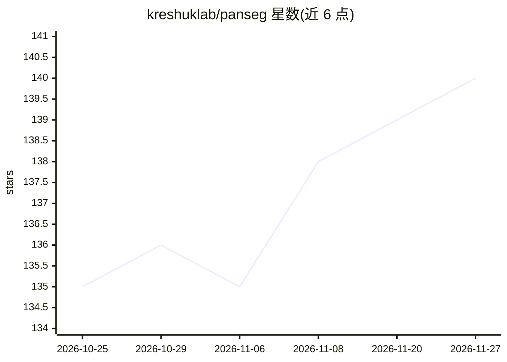

# kreshuklab/panseg

⭐ 140 · Python · MIT · 推送 2026-11-26 · [GitHub](https://github.com/kreshuklab/panseg) · [官网](https://kreshuklab.github.io/panseg/latest/) · 组织维护

**给研究人员做密集 3D 体积图像细胞实例分割的工具**

PanSeg 面向高度密集的 3D 体积显微图像中的细胞实例分割，采用神经网络+分割的两阶段流水线，针对共聚焦与光片显微镜获取的植物细胞组织调优，并随附预训练模型。项目由 PlantSeg 更名而来，自 2.0 起同时覆盖植物与动物细胞。提供图形安装器（内置 python 与 conda）、开发用 conda 环境文件、示例数据、自动化测试及论文定量评估的复现脚本。

## 筛选速览

| 维度 | 判定 | 备注 |
|---|---|---|
| AI 角色 | `ai-native` | 本体是模型或模型工具 |
| 许可风险 | `permissive` | MIT |
| 部署形态 | `None` |  |
| 模型依赖 | — | README 未给出锁定关系 |
| 硬件要求 | — | 无带数字的原话,不猜 |
| 安装摩擦 | `low` | 无编译、无系统依赖或容器化 |
| 成熟度 | — | 结构信号不足 |

## 能力要点

- 两阶段流水线：神经网络 + 分割
- 提供预训练模型
- 针对共聚焦/光片显微镜植物组织调优
- 含评估脚本与自动化测试

## 适用场景

- 对光片/共聚焦显微图像做细胞级 3D 实例分割
- 复现 Wolny et al. 论文中的定量评估
- 分割植物或动物组织的密集细胞结构

## 场景标签

`目标检测` · 领域:感知与多模态

## 证据(README 行号)

> L16: PanSeg is a tool for cell instance aware segmentation in densely packed 3D volumetric images.
> L17: The pipeline uses a two stages segmentation strategy (Neural Network + Segmentation).

## 星数曲线

2026-10-25 135 → 2026-11-27 140（+5）

---
*卡片 v1 · prompt 1.4 · 生成 2026-11-27 · 置信度 high · 依据 README sha `9074e3ca0f89` · [字段定义](../../DATASET.md)*
