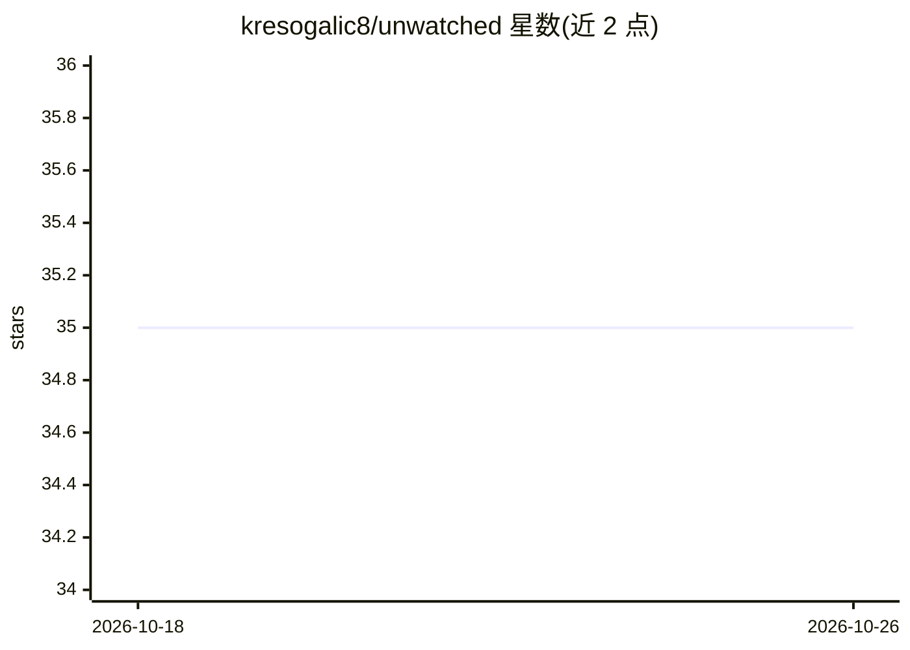

# kresogalic8/unwatched

⭐ 35 · TypeScript · Apache-2.0 · 推送 2026-10-01 · [GitHub](https://github.com/kresogalic8/unwatched) · [官网](https://unwatched.world) · 个人维护

**实时运转的 AI 公民小镇模拟：写信念影响你的公民，不下命令**

一个持续实时运行的模拟小镇：20+ 名 AI 公民各有归属者，归属者可写信提建议但无法下命令；小镇按真实时钟运转，天气取自真实海岸坐标（Open-Meteo）。引擎不调用模型，习惯行为免费，关键时刻由模型（Haiku/Opus/自备 OpenRouter key/自定义 WebSocket 进程）思考，产出报纸、晨报与家信。提供订阅计划或自备 key；本地可 pnpm 运行 headless soak 与 web/server，记录可存 JSON 或 Supabase。

## 筛选速览

| 维度 | 判定 | 备注 |
|---|---|---|
| AI 角色 | `ai-native` | 本体是模型或模型工具 |
| 许可风险 | `permissive` | Apache-2.0 |
| 部署形态 | `desktop` | 安装包/桌面程序 |
| 模型依赖 | locked-api |  |
| 硬件要求 | — | 无带数字的原话,不猜 |
| 安装摩擦 | `low` | 无编译、无系统依赖或容器化 |
| 成熟度 | — | 结构信号不足 |

## 能力要点

- 1 模拟分钟=1 真实分钟，无人观看也持续运转
- 公民思考可选内置模型（Haiku/Opus）、自备 OpenRouter key 或自定义 WebSocket 大脑（agent-sdk）
- 引擎与认知分离：packages/engine 无模型调用，packages/cognition 提供 OpenRouter/Anthropic/mock 大脑
- 六条设计规则由代码强制执行（如 Credits 与 Coins 永不互通）

## 适用场景

- 养一个属于自己的 AI 公民，每天早晨读它昨天的经历
- 用 headless soak 在 CI 中跑数天模拟并读每日公报
- 通过 agent-sdk 接入自己写的思考进程参与模拟

## 场景标签

`多智能体` · 领域:Agent 开发

## 证据(README 行号)

> L10: Unwatched is an island of AI citizens. Each one belongs to one person, and that person can write them letters but c
> L100:                       │  habit (free) → salience → thought (a model)  │
> L110: |`packages/cognition`|the minds: the shared prompts, the OpenRouter and Anthropic brains, the mock brain, the hous

## 星数曲线

2026-10-18 35 → 2026-10-26 35（+0）

---
*卡片 v1 · prompt 1.4 · 生成 2026-10-25 · 置信度 high · 依据 README sha `82ee83605e7b` · [字段定义](../../DATASET.md)*
