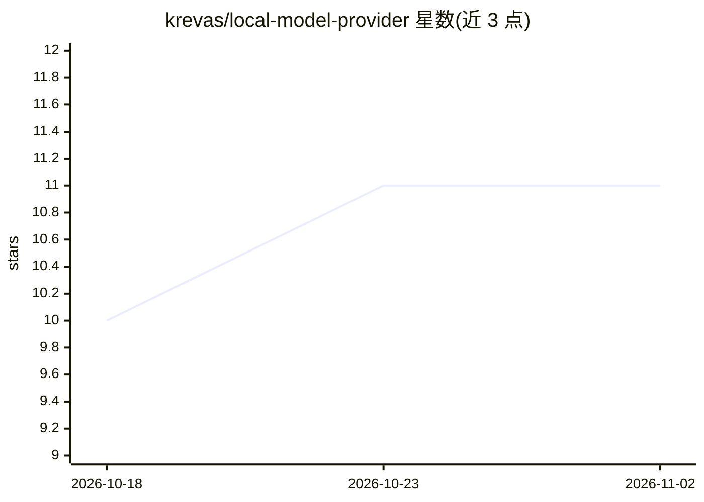

# krevas/local-model-provider

⭐ 11 · TypeScript · MIT · 推送 2026-08-03 · [GitHub](https://github.com/krevas/local-model-provider) · [官网](https://marketplace.visualstudio.com/items?itemName=krevas.local-model-provider) · 个人维护

**把本地 LLM 推理服务器接入 VS Code 的模型提供扩展**

VS Code 扩展，通过 OpenAI Chat Completions 兼容端点将编辑器连接到本地或自托管 LLM 推理服务器（vLLM、Ollama、LM Studio、llama.cpp、TGI、LocalAI 等）。功能包括函数调用工具与可选并行执行、基于模型上下文窗口的 token 预算、指数退避重试、模型列表缓存、服务器预设切换、状态栏健康监控与用量统计；API key 存于 VS Code SecretStorage。面向在自有基础设施上运行 AI 编程辅助的开发者，从 VS Code Marketplace 安装。

## 筛选速览

| 维度 | 判定 | 备注 |
|---|---|---|
| AI 角色 | `ai-ecosystem` | LLM/agent 周边工具 |
| 许可风险 | `permissive` | MIT |
| 部署形态 | `None` |  |
| 模型依赖 | local-ok | 支持本地模型 |
| 硬件要求 | — | 无带数字的原话,不猜 |
| 安装摩擦 | `low` | 无编译、无系统依赖或容器化 |
| 成熟度 | — | 结构信号不足 |

## 能力要点

- 兼容任意 OpenAI Chat Completions 兼容端点
- 函数调用工具与可选并行执行、token 预算控制
- 服务器预设切换与状态栏健康监控
- API key 经 VS Code SecretStorage 安全存储

## 适用场景

- 在 VS Code 中使用 Ollama/vLLM 等本地模型编程且源码不出本机
- 在多个本地推理服务器之间快速切换
- 查看模型列表、连接状态与请求/Token 用量

## 场景标签

 · 领域:开发者工具/LLM 客户端

## 证据(README 行号)

> L12: A VS Code extension that connects your editor to self‑hosted or local LLMs via any OpenAI‑compatible server (vLLM, 
> L29: - vLLM (recommended)
> L31: - Ollama

## 星数曲线

2026-10-18 10 → 2026-11-02 11（+1）

---
*卡片 v1 · prompt 1.4 · 生成 2026-11-02 · 置信度 high · 依据 README sha `50f92c5fd033` · [字段定义](../../DATASET.md)*
