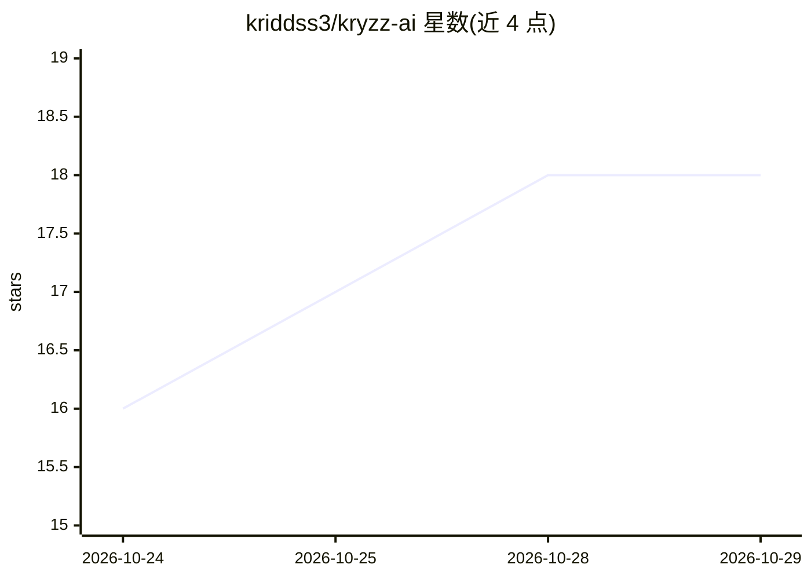

# kriddss3/kryzz-ai

⭐ 18 · Kotlin · MIT · 推送 2026-10-23 · [GitHub](https://github.com/kriddss3/kryzz-ai) · [官网](https://github.com/kriddss3/kryzz-ai/releases/latest) · 个人维护

**Android 本地优先 AI 工作台：自带 API key 的聊天/语音/Agent**

Kotlin + Jetpack Compose 编写的 Android 应用，以 BYOK（自带 API key）方式提供 Chat 对话、多步工具 Agent 与语音交互三种模式。API key 经 Android Keystore 加密存储，会话、记忆与生成文件保存在本地 Room/DataStore，无遥测与账号。模型本身运行在 OpenRouter、MiniMax 等托管服务商处；模型不在手机本地运行。Agent 可产出 DOCX/XLSX/PDF/SQLite 等文件，带每回合费用上限（默认 $0.25）。通过 GitHub Release 发布 APK（Android 9+），亦可从源码构建。

## 筛选速览

| 维度 | 判定 | 备注 |
|---|---|---|
| AI 角色 | `ai-native` | 本体是模型或模型工具 |
| 许可风险 | `permissive` | MIT |
| 部署形态 | `desktop` | 安装包/桌面程序 |
| 模型依赖 | locked-api |  |
| 硬件要求 | — | 无带数字的原话,不猜 |
| 安装摩擦 | `medium` | 含编译或系统依赖之一 |
| 成熟度 | — | 结构信号不足 |

## 能力要点

- Chat/Agent/Voice 三模式，Agent 可生成 DOCX、XLSX、PDF、SQLite 与代码 ZIP
- API key 经非导出 Android Keystore 密钥 AES-GCM 加密，无遥测无账号
- 每回合费用上限（默认 $0.25，可调至 $2）
- 支持 OpenRouter 必选 + MiniMax/Parallel/Fish Audio 可选的 provider 组合

## 适用场景

- 在 Android 手机上用自己付费的 API key 进行 AI 聊天与语音对话
- 让 Agent 执行搜索、研究并产出文档/表格/PDF 等文件
- 在不上传会话数据、无遥测的前提下使用托管模型服务

## 场景标签

`AI 助手` `聊天机器人` `语音 Agent` · 领域:对话与助手

## 证据(README 行号)

> L5: **A private AI workspace for Android: chat, autonomous agents, and voice in one app, running on your own API keys.**
> L35: - **Three modes, one app.** Chat for conversations, Agent for multi-step tool work, Voice for hands-free talking wi
> L100: **Does it run models on my phone?** No. Kryzz is a client for hosted model APIs. "Local-first" means your conversa

## 星数曲线

2026-10-24 16 → 2026-10-29 18（+2）

---
*卡片 v1 · prompt 1.4 · 生成 2026-10-29 · 置信度 high · 依据 README sha `c09e613044eb` · [字段定义](../../DATASET.md)*
